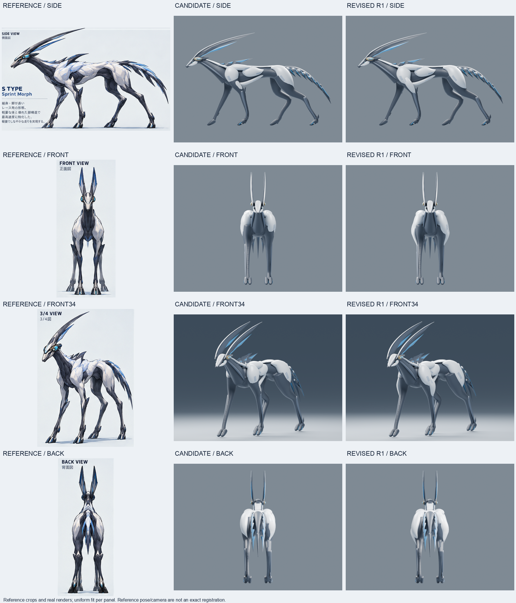
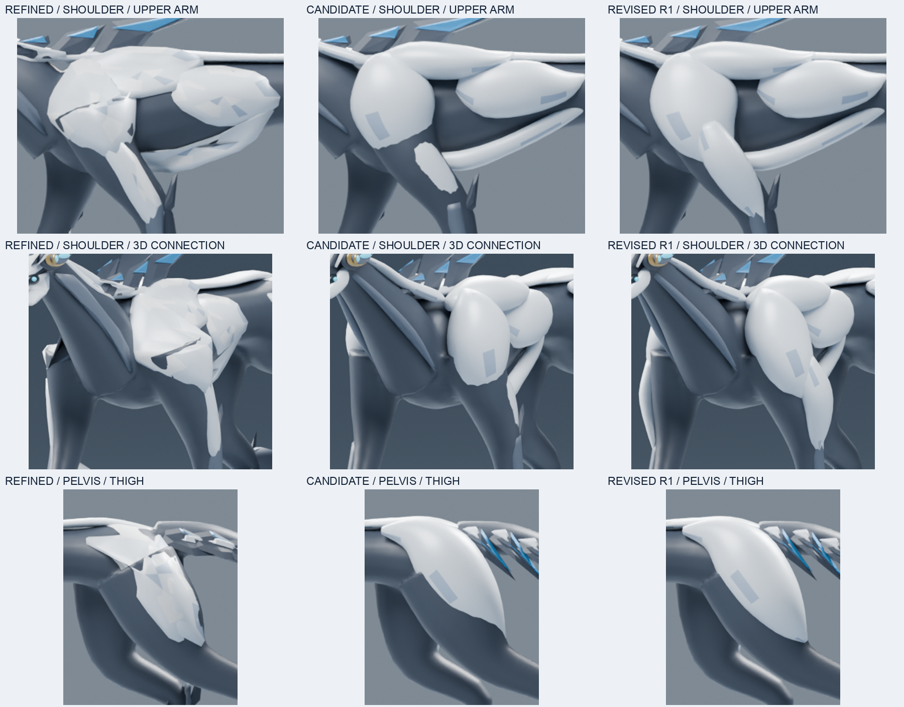

# S ZERO 実モデル品質評価 — 2026-10-17

**判定: CANDIDATE = REVISE / REVISED R1 = REVISE。production KEEP ではない。**

3つの原本を保護・GitHubへ保存し、CANDIDATEの実モデルを5方向から評価した。
その結果に基づき、肩・上腕・骨盤だけを別名ファイルで実際に造形修正した。
R1は接続の見え方を改善した継続用の作業モデル。原画一致とリギング準備の課題は残る。

## 成果物と保護

- 保全branch: `exp/s-fullbody-zero-verify-20261017`
- 原本保全commit: `44357d30cdbe8f5ac3f9528352e84fa24aef41de`
- [BLOCKOUT原本](S_ZERO_BLOCKOUT.blend): 1,171,877 bytes
- [REFINED原本](S_ZERO_REFINED.blend): 1,178,832 bytes
- [CANDIDATE原本](S_ZERO_CANDIDATE.blend): 1,224,567 bytes
- [検証用コピー](verification/S_ZERO_CANDIDATE_REVIEW.blend): CANDIDATEとバイト一致。
- [造形修正版 R1](S_ZERO_CANDIDATE_REVISED_R1.blend)

原本のSHA256は[README](README.md)および[保護台帳](evidence/ORIGINAL_ARTIFACTS.json)に記録。
R1 SHA256: `f8e8a80360ee5886d485a17610cf62a9387d10cdb09e4801a055be99bf8d8a4f`。
3原本およびR1はBlender **4.3.2 / 32f5fdce0a0a**で開いて検査した。
原本26成果物（モデル、既存スクリプト、画像、記録）は作業前後で全SHA256が一致した。
過去のローカルbranch先端も一致。push先は新branchだけで、mainへの変更・merge・本番差替えは行っていない。

[GitHub原本再取得照合](evidence/REMOTE_PRESERVATION.json)は、原本3つをGitHub APIから実際にダウンロードし、
各バイトとSHA256がローカル原本に一致することを記録している。

## 評価根拠

- 最上位の制作基準: [00_s_type_modeling_image_v1.png](../references/00_s_type_modeling_image_v1.png)
  — SHA256 `93befcfdbe8863abd3140ec6b92d9f06ca2dcbf70bb551334eb063831b9831f6`。
- リポジトリ共通原画と `docs/creature-reference-index-v0.1.md`、S modeling handoff / correction lockも確認。
- 既存REFINEDの実レンダリング SIDE / FRONT / FRONT34 と比較。
- CANDIDATEとR1それぞれ SIDE / FRONT / FRONT34 / REAR34 / BACK を実レンダリング。
- Cycles CPU、32 samples、1200 × 900、同一camera matrix・ortho scale・seed・色管理。
  R1では照明・背景・カメラも変更していない。
- 比較画像は実レンダリングと原画の切抜き・等比縮小・配置のみ。生成画像やレタッチによる形状変更なし。
  原画はイラストのため、比較画像は厳密な投影位置合わせではない。

## 部位別評価

| 評価箇所 | CANDIDATEの現物 | R1での結果 / 残課題 |
| --- | --- | --- |
| 頭部と二本の冠 | 小さな頭、二本の後方へ流れる冠、控えめな眼、Cue Bandを保持。正面では冠が細い平行線に寄り、原画の中腹の面幅と絞りが不足。額も滑らかすぎる。 | 今回は形状を維持。正面冠断面・根元・額の面構成は次の形状課題。 |
| 肩・胸・上腕 | REFINEDの大きな投影折れ込みは消えた。肩は丸い別部品感が強く、肩下と上腕白色部に暗い分断。上腕白色部の多くが本体へ埋没していた。 | 既存頂点を動かし肩下から上腕へ白い量感をつないだ。SIDE/FRONT34/REAR34で白い孤立片が減少。FRONTでは外側に白い縁が強く出ており、原画の面に沿う整理は残る。 |
| 胴体・腹部 | 腰の絞りは存在し、S型の細身を保持。背中と下肋骨の白い帯は丸い棒状に見える箇所がある。 | 連続本体、肋骨、背中は形状ハッシュ一致。腹部の絞りは維持。帯と本体の造形統合が残る。 |
| 腰・骨盤・後脚 | REFINEDの大きな折れ込みは解消。骨盤下端には本体が食い込む不規則な白黒境界。後脚の大腿・後方への関節角は読み取れる。 | 骨盤の外側の丸みをわずかに抑え、下端を本体外側へ整えた。SIDE/REAR34で輪郭が連続。BACKの本体との段差と別部品感は残る。 |
| 四肢・足先 | 4本の脚は連続本体につながる。下肢は先細りだが筒状。割れた2本の足先は丸く、原画の楔形・接地面・足首構造が不足。 | 上腕以外は形状を維持。脚長、下腿、足先の改善は未実施。 |
| 尾 | 独立した細い根元、曲線、左右の刃状の層は存在。後方からは中央の裸の棒と反復する薄板が目立つ。 | 形状を維持。原画の有機的な層の重なり、根元と各層の厚みの接続が残る。 |
| 全身の輪郭・立体感 | 小頭、細い腰、長脚、二冠、細い尾にSの同一性が見える。白い卵形の量感と正面の冠の細さが原画と異なる。 | 肩上腕の読みやすさは向上。5方向で全身は維持。静止128pxプレビューでも長脚・冠は読めるが、これは実レースの画面サイズ・動作検証ではない。 |
| 接続・交差 | 本体は1つの連結成分。各メッシュは閉じているが、別メッシュの表面が本体と交差する。肩・腰の見た目を「穴なし」とは判定できない。 | 個別メッシュの境界欠損は新設していない。別メッシュ間の交差は残存し、一体化済みとは扱わない。 |
| 将来のリギング | Armature、Action、vertex groupなし。ボクセル由来の本体トポロジーに関節用のエッジ流れがなく、左右はずらした立ち姿。 | 形状修正だけで、変形用構造は未対応。肩・股関節のリトポロジー、別部品の追従、左右の基準姿勢と接地の整理が必要。 |

## REFINEDの裂け目は修正されたか

**大きな折れ込みはCANDIDATEで改善したが、肩・腰の接続問題がすべて解決したとは判定しない。**

REFINEDの表面投影でできた鋭い折れ・細い裂け目状の陰影は、CANDIDATEの閉じた立体で軽減している。
一方、白い肩/骨盤と暗い本体は独立した重なり合うメッシュであり、暗い本体が白色部の下端から現れて
裂け目のように見える。CANDIDATEのSIDEとFRONT34、BACKでこの境界を確認した。
R1では肩・上腕の連続性と骨盤下端を改善したが、完全な面接続や変形時の交差解消はしていない。

## 実施した造形修正

[08_revise_connections.py](scripts/08_revise_connections.py)をCANDIDATEの検証用コピーにだけ適用し、別名へ保存した。
元の生成スクリプトは実行していない。既存の6メッシュの頂点だけを調整した。

- `DELTOID_N/F`: 肩の上側の横方向の膨らみを抑え、下端を上腕方向へ調整。
- `BRACHIAL_FORE_NEAR/FAR`: 埋没していた上腕の面を外側へ出し、肩下へつなげた。
- `PELVIS_N/F`: 上側の横膨らみを抑え、下部の面が本体に隠れる量を減らした。

投影補正は同じ側の本体へのヒットだけに限定し、変位の上限を設定した。
REFINEDで問題となった別の脚への投影ジャンプを避けた。
他の**144メッシュは頂点・面構成ハッシュが一致**し、全メッシュの頂点数・面構成も変更していない。
詳細は[変更記録](evidence/REVISION_R1.json)。

## 構造検査と限界

- CANDIDATE / R1とも、creature collectionは150 meshes + root empty 1。
- 41,302 vertices / 42,386 polygons。これらの数は品質合格の根拠ではない。
- 連続本体は27,534 verticesの1連結成分。
- 全150メッシュでboundary edge / nonmanifold edge / loose vertex / 1e-12未満の面積faceは0。
- 肩・上腕・骨盤・肋骨・背中など14部位のBVH検査では、隣接面を除いた自己交差候補は0。
  この検査は完全な自己交差証明ではない。
- 本体との面交差はCANDIDATEとR1の両方で検出。例えば近側DELTOIDでは140→168面ペア。
  交差数の増減を品質の点数として使わず、別メッシュの交差が残っている証拠として扱う。
- [原本検査](evidence/VERIFY_SAVED_ORIGINALS.json) /
  [R1再読込検査](evidence/VERIFY_S_ZERO_CANDIDATE_REVISED_R1.json) /
  [CANDIDATE接続検査](evidence/STRUCTURE_candidate_review.json) /
  [R1接続検査](evidence/STRUCTURE_revised_r1.json) /
  [原本保護・同一カメラ確認](evidence/FINAL_LOCAL_CHECKS.json)。

モーション / 歩様 / PC・mobile runtimeは未実施。モデルは未rigで、productionへの昇格を行っていない。

## 5方向と比較画像

| 方向 | CANDIDATE 実レンダリング | R1 実レンダリング |
| --- | --- | --- |
| SIDE | [SIDE](renders/candidate_review/SIDE.png) | [SIDE](renders/revised_r1/SIDE.png) |
| FRONT | [FRONT](renders/candidate_review/FRONT.png) | [FRONT](renders/revised_r1/FRONT.png) |
| FRONT34 | [FRONT34](renders/candidate_review/FRONT34.png) | [FRONT34](renders/revised_r1/FRONT34.png) |
| REAR34 | [REAR34](renders/candidate_review/REAR34.png) | [REAR34](renders/revised_r1/REAR34.png) |
| BACK | [BACK](renders/candidate_review/BACK.png) | [BACK](renders/revised_r1/BACK.png) |

- [CANDIDATE 5方向一覧](comparisons/CANDIDATE_FIVE_VIEWS.png)
- [R1 5方向一覧](comparisons/REVISED_R1_FIVE_VIEWS.png)
- [5方向の変更前後](comparisons/BEFORE_AFTER_FIVE_VIEWS.png)
- [原画比較](comparisons/REFERENCE_COMPARISON.png)
- [肩・腰の拡大比較](comparisons/SHOULDER_HIP_PROGRESS.png)
- [静止128pxプレビュー](comparisons/STATIC_128PX_PREVIEW.png)

継続時はR1の別名コピーから、肩・骨盤の原画の面構成と接続トポロジーを優先して扱う。
次に正面冠断面、足先、尾の層構造を個別に評価する。原本3つとR1は保存点として保持する。
