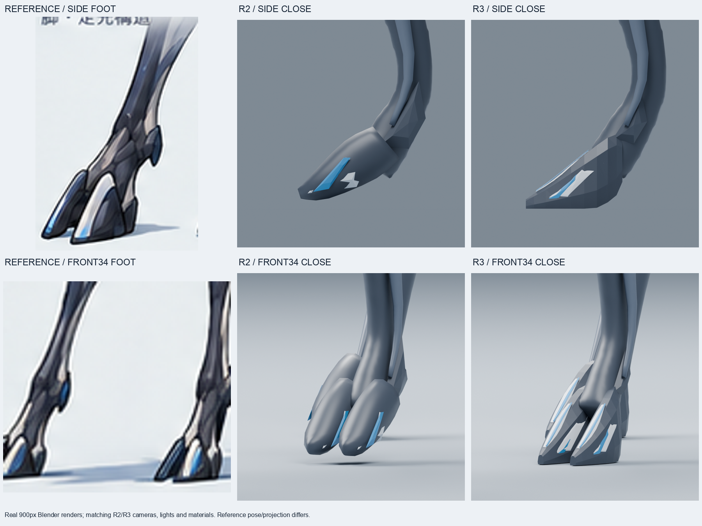

# S ZERO R3 実造形・品質評価 — 2026-10-18

**全身判定: REVISE。足先・足首周辺の局所改善を継続用R3として採用。本番KEEPではない。**

[S_ZERO_CANDIDATE_REVISED_R3.blend](S_ZERO_CANDIDATE_REVISED_R3.blend)は、保存済みR2のバイト一致コピーを起点にBlender MCPで編集した実モデル。
全身生成器・外部ドナー・画像生成は使用していない。R2を含む既存モデルは上書きしていない。

## 再起動後の復旧と保全

- 開始branch: `exp/s-fullbody-zero-verify-20261017`、local `fbe8d50`、fetch後remote `d361c8345f93174d977646dd707ae6f7530afdd9`。
- remoteが23コミット先行。履歴は分岐していなかった。既存R2モデル・5方向画像・比較画像・試作モデルをGit blob SHAで照合し、一致する23追加ファイルを認識させてfast-forwardした。
- 作業前の124ファイル、66,515,426 bytesを一時領域のtarとSHA256台帳に退避。[開始台帳](evidence/R3_RECOVERY_START.json)。
- 未反映だったR2評価書・制作スクリプト・JSON・ログ32ファイルだけを`6d6d1d0`でcommitし、同じ保全branchへ通常pushした。
- Blender **4.3.2 / 32f5fdce0a0a**とlocalhost:9876のBlender MCPが稼働していることを確認。再起動や手動造形は不要だった。
- R2を実際に開き直して5方向を再レンダリング。保存済みR2画像と**5方向すべてRGB画素一致**。[再現確認](evidence/R3_R2_REPRODUCTION_CHECK.json)。

`git reset --hard`、`git clean`、force push、既存モデルの上書きは実施していない。

## 原画と実際の変更

最上位基準は[00_s_type_modeling_image_v1.png](../references/00_s_type_modeling_image_v1.png)。
共通原画、creature reference index、S modeling handoff、S correction lockも確認した。
優先箇所を足先に限定し、冠・肩・骨盤・尾を同時に修正していない。

| 箇所 | R2 | R3 |
| --- | --- | --- |
| 8本の分割した足先 | 丸い長円形。前方への楔形と底面が弱い | **既存頂点**を移動し、前方へ先細る楔形、斜めの上面、側面、平らな底面を形成。二股の間隙を保持 |
| 足先の後端・付け根 | 丸い部品が足首に重なる | 試作Aの後端が箱状だったため、試作Bで後端幅を最大20%絞り、底面後部を持ち上げて足首側への移行を調整 |
| 白・青の表面形状32個 | 丸い足先に埋もれたり、小片として浮いて見える | 既存メッシュを楔形の上面・側面に沿わせ、上面の丸いキャップを薄くした。既存の色・材質を使用 |
| 足首周辺の小突起4個 | 長い突起。遠側前脚では足首より上の下腿に位置する | 既存頂点を編集し高さを72%、前後幅を78%へ縮小。足先の付け根へ移動。突起を追加していない |
| 接地 | 最下点と床の間隔は約0.02617 model units | 8本ともZ=-0.016に15面の平らな底面。床Z=-0.018との間隔は0.002。浮きを縮小したが、物理的な接地・歩様検証ではない |

変更は**44メッシュ**のみ。残る**100メッシュ**はR2と一致。
R2の肩・上腕を含む連続本体は頂点・面・カラー属性を保持し、二冠6メッシュも完全一致。
頭部、眼、Cue Band、胴体、骨盤、下肢の本体、尾、立ち姿を保持した。
オブジェクト追加・削除、頂点数・面数・接続関係の変更はない。

## 段階的な判断

1. **試作A: REVISE**。SIDE / FRONT / FRONT34で楔形と底面の改善を確認したが、後端の箱状の量感が残った。
2. **試作B: 継続用として採用**。後端の絞り・底面後部の持ち上げ・既存足首突起の整理を実施。同じ3方向と足先の拡大実レンダリングで確認した。
3. 再読込構造検査後、BをR3へ別名保存。R3を再読込し、最終5方向と近接2方向を新たにレンダリングした。
4. 最終R3の3方向＋近接2方向は、評価済みBとRGB画素一致。保存時の形状変化がないことを確認した。

[試作判断](evidence/SCULPT_R3_REVIEW.json) /
[試作A比較](comparisons/R3_TRIAL_A_FOOT_DETAILS.png) /
[試作B比較](comparisons/R3_TRIAL_B_FOOT_DETAILS.png) /
[最終確認](evidence/R3_FINAL_LOCAL_CHECKS.json)。

## 5方向の評価

| 方向 | 改善・保持 | 残課題 |
| --- | --- | --- |
| [SIDE](renders/revised_r3/SIDE.png) | 足先の前方への楔形、底面、後端の斜面が読める。R2の肩接続と冠の長い輪郭を保持 | 足首本体と足先は別メッシュ。肩・骨盤の滑らかすぎる面構成は未修正 |
| [FRONT](renders/revised_r3/FRONT.png) | 二股の足先と左右の底面、上面の白青の面が読める | 足首中央の本体の終端が角張る。冠の正面断面・根元はR2のまま |
| [FRONT34](renders/revised_r3/FRONT34.png) | 丸く浮いた足先から、底面を持つ楔形へ改善。足首側の後端の厚みを抑制 | 拡大時には面の折れと白青の境界の不揃いが残る。滑らかな一体造形とは評価しない |
| [REAR34](renders/revised_r3/REAR34.png) | 後端の斜面と足首から足先への位置関係を確認。後脚の角度は保持 | 骨盤の別部品感、尾の薄い反復板と中央軸が残る |
| [BACK](renders/revised_r3/BACK.png) | 後方からも分割した足先・底面が読める。冠・腰・尾はR2を保持 | 足先と本体の接続トポロジー、骨盤・尾の構造は未完成 |

[5方向一覧](comparisons/REVISED_R3_FIVE_VIEWS.png) /
[原画・R2・R3比較](comparisons/REVISED_R3_REFERENCE_R2_COMPARISON.png) /
[R2/R3 5方向比較](comparisons/REVISED_R3_R2_FIVE_VIEW_COMPARISON.png) /
[足先拡大](comparisons/REVISED_R3_FOOT_DETAILS.png) /
[静止128px比較](comparisons/REVISED_R3_STATIC_128PX.png)。

静止128pxでは小頭・長脚・二冠・細い腰と尾の読みを保持。足先の細部差は小さく、実レースサイズの動作検証の代用にはならない。
画像はCycles CPU / 32 samples / seed 17。全身1200×900、近接900×900。
R2/R3は同一カメラ行列・orthographic scale・照明・材質・色管理。
比較画像は実レンダリングの切抜き・等比リサイズ・配置・文字だけ。原画の姿勢と投影はモデルと完全一致ではない。

## 保存・構造検査

- R3: **1,239,953 bytes**、SHA256 `b3e1b1820c3019a7b466b81e06276d8585fdeb25ec425ac2a6219e55bd06a916`。
- R2保持: SHA256 `3406e12f54670ca397eb31825721aa08e36fbc46a0bc68e2dcfbcbaae0c09662`。
- R3再読込: **144 meshes / 39,691 vertices / 40,014 faces**。全メッシュの境界辺・非多様体辺・孤立頂点・面積1e-12未満の面は0。
- 44変更メッシュと連続本体の非隣接面BVH自己交差候補は0。完全な自己交差証明ではない。
- 既存123成果物のSHA256一致を検査。更新する総合評価文書だけを照合対象外にした。
- 保存時にBlenderが未使用・users=0の重複材質5件を整理した。実際の材質スロット、使用中の材質ノード、照明、カメラ、背景、色管理は一致。
- 最初の保存試行はMCP timer内の画面context参照で停止した。画面取得を修正し、未作成だったR3へ保存・再読込を完了。失敗時にモデルは書き出されていない。

[再読込検査](evidence/VERIFY_S_ZERO_CANDIDATE_REVISED_R3_RELOAD.json) /
[保存記録](evidence/R3_SAVE.json) /
[R3レンダリング記録](evidence/RENDER_revised_r3.json)。

## 判定と次の課題

**局所改善を継続用R3として採用する。全身はREVISEを継続する。**
足先の形は原画へ近づいたが、足首本体との境界、角張った面・色境界には整理が必要。
冠の正面断面・根元、肩・骨盤の面構成、尾の厚みと層のつながりは今回修正していない。
Armature / Actionなし。リトポロジー、歩様、PC/mobile runtimeは未実施。本番モデルへの差替え・昇格は行っていない。

## 再現とGitHub

新しい検証用checkoutで、Blender MCPから[19_sculpt_r3_feet.py](scripts/19_sculpt_r3_feet.py)、
[22_refine_r3_heel_ankle.py](scripts/22_refine_r3_heel_ankle.py)の順に実行する。
各段階の実画像を評価し、[23_verify_r3.py](scripts/23_verify_r3.py)でBを検査してから
[24_save_reviewed_r3.py](scripts/24_save_reviewed_r3.py)でR3を保存する。既存出力の上書きは拒否する。

送信先は`badjoke-lab/evowild-test`の保全branch。
GitHub上のtree照合とモデル・5方向・比較画像・スクリプト・評価書の再ダウンロード結果は
[REMOTE_R3_FINAL_VERIFY.json](evidence/REMOTE_R3_FINAL_VERIFY.json)に記録する。
