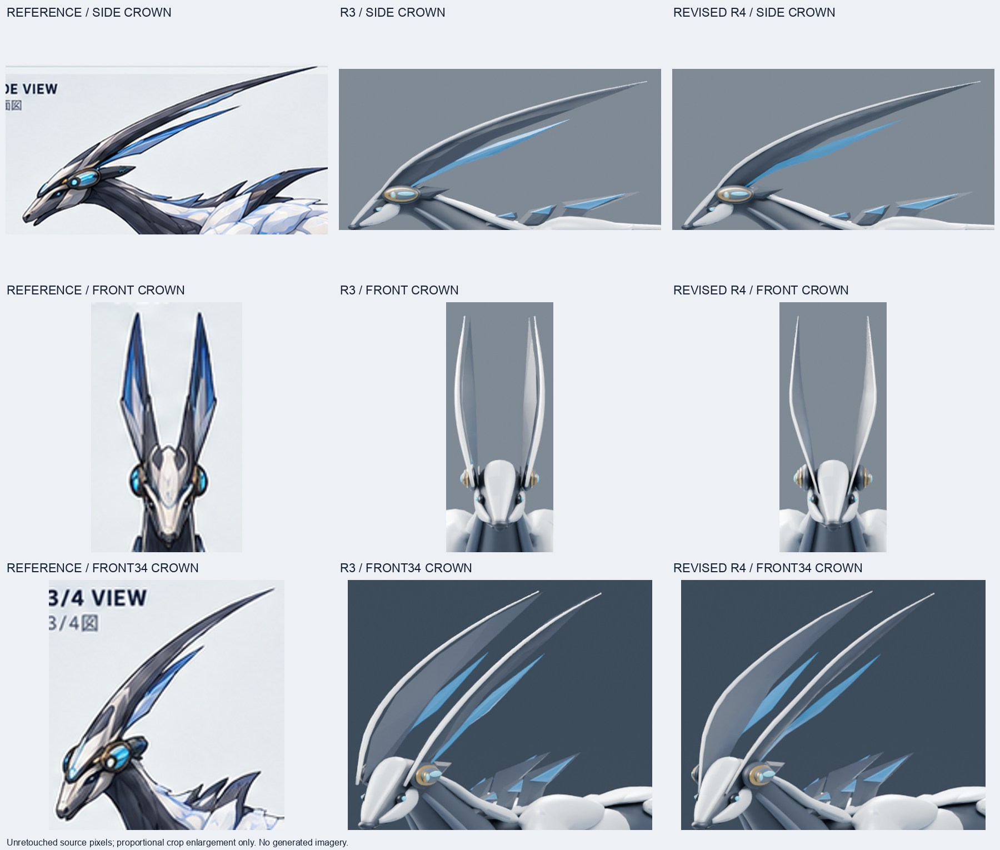

# S ZERO R4 冠の実造形・品質評価 — 2026-10-19

**全身判定: REVISE。冠の局所改善を継続用R4として採用。本番KEEPではない。**

[S_ZERO_CANDIDATE_REVISED_R4.blend](S_ZERO_CANDIDATE_REVISED_R4.blend)は、保存済みR3のバイト一致保護コピーから、Blender MCPで既存の冠メッシュだけを編集した実モデル。
全身生成器・外部ドナー・画像生成は使用していない。R3と過去のモデル・画像・評価書は上書きしていない。

## 安全な再開

- worktree: `/Users/lyla/evowild-s-zero-20261017`
- branch: `exp/s-fullbody-zero-verify-20261017`
- 開始local HEAD / fetchしたremote HEAD: **`005d1b9dbf22291805f479dcc97c29c1da6a1e24`**。差分0 / 0、fast-forward不要。
- remote tracking refが設定されていないため、fetchされた`FETCH_HEAD`を直接照合。GitHub APIでも同じbranch HEADを確認した。
- 前回の未commit 2ファイル（`27_publish_r3_git_objects.py`、`R3_GIT_OBJECT_UPLOAD.json`）を一時領域へ保護し、今回の送信対象から除外。開始時の209成果物をSHA256で記録した。
- Blender **4.3.2 / 32f5fdce0a0a**、localhost:9876のBlender MCP稼働を確認。初期シーンは未変更。R3の保護コピーを開き、`REVISED_R3`・未保存変更なし・R3のSHA256一致を確認した。
- 共通原画、creature reference index、S handoff / correction lockを参照。sparse checkoutで未展開の文書は`git show HEAD:...`で読んだ。
- `git reset --hard`、`git clean`、force push、原本上書きは実施していない。

[開始記録](evidence/R4_RECOVERY_START.json) / [R3読込](evidence/R4_OPENED_R3.json)

## 原画との差と変更

最上位基準は[00_s_type_modeling_image_v1.png](../references/00_s_type_modeling_image_v1.png)。
原画と保存済みR3のSIDE / FRONT / FRONT34を実画像で比較した。

| 部位 | R3で確認した差 | R4で行った実編集 | 残る差 |
| --- | --- | --- | --- |
| 根元 | Cue Bandの横から細い先端が独立して立つ印象。額との立体的なつながりが弱い | 既存頂点を内側・前下方へ寄せ、額に埋まる根元へ変更。最大X -0.018 / Z -0.045、下部22%だけに減衰して適用 | 額へ埋め込んだ別メッシュのまま。原画の連続する面構成・一体接続には未到達 |
| 中腹 | 正面で丸く弓なりの細い帯と白いレールに見える | 高さごとの前後縁位置を変え、斜めの厚みを持つレンズ断面へ。根元から広がり、中腹を経て先端へ絞る。白い縁の横断面を48%へ薄くした | 正面の青い面と長手方向の明確な稜線は不足。広がりの改善は局所的 |
| 先端 | 側面の長さは有効だが、正面では厚み・縁が別々に収束して見える | 主冠の前後縁を同じY位置へ収束。上部の幅を絞り、長いX/Z輪郭を保持 | 原画の尖り方と面の切り替えは完全一致ではない |
| 冠内部 | 元の放射状の面接続が、ねじった断面では凹形輪郭をまたいで折り返す | 元の輪郭頂点を保持し、主冠・青い面の内部だけを再接続。対応する表裏の面を持つ閉じた立体に修正 | リギング用の全身リトポロジーではない |

変更メッシュは以下の**6個**のみ。

- `CROWN_MAIN_N` / `CROWN_MAIN_F`
- `CROWN_BLUE_N` / `CROWN_BLUE_F`
- `CROWN_IVORY_RIDGE_N` / `CROWN_IVORY_RIDGE_F`

残る**138メッシュ**はR3と一致。連続本体、肩・胸・上腕、胴体、骨盤、足先・足首、頭部、眼、Cue Band、尾を保護した。
オブジェクト追加・削除、姿勢変更、材質変更はない。主冠と青い面の内部トポロジー、および冠のシェーディングは変更した。
主冠の根元より上（Z>=2.40）の元輪郭8頂点は、左右それぞれX/Z一致を確認した（許容誤差1e-6）。

同じ水平断面で測った主冠片側のY幅（model units、原画からの採寸ではない）:

| 高さZ | R3 | R4 | 読み方 |
| --- | ---: | ---: | --- |
| 2.28 | 0.02058 | 0.02739 | 根元付近に幅を確保し、内側へ寄せた |
| 2.60 | 0.07353 | 0.07723 | 中腹の幅をわずかに増やし、面の向きを調整 |
| 3.02 | 0.01698 | 0.01188 | 上部を細く絞った |

## 試作と取り消し

1. **Aは不採用**。中腹の広がりが急で、板状の面と交差候補が生じた。
2. **B / Cも不採用**。輪郭を抑えたが、内部の面接続に交差候補が残った。各段階でR3の保護コピーへ戻して修正した。
3. **Dで内部の面接続を修正**。側面輪郭を維持したまま、冠6個の非隣接面BVH交差候補が0になった。最初のD試行は辺の共有検査で保存前に停止し、共有を直して再実行した。
4. **Eを継続用R4に採用**。Dの頂点・輪郭を保ち、不要な三角分割の陰影を補間。35度を超える実際の折れはsharp edgeとして残した。SIDE / FRONT / FRONT34の実レンダリングで比較した。
5. EをR4へ別名保存し、ライブBlenderと独立プロセスで再読込。最終5方向を新規レンダリングした。

[試作判断](evidence/SCULPT_R4_REVIEW.json) / [E比較](comparisons/R4_TRIAL_E_CROWN_COMPARISON.png) / [保存記録](evidence/R4_SAVE.json)

## 5方向と実ビューポート

| 方向 | 評価 |
| --- | --- |
| [SIDE](renders/revised_r4/SIDE.png) | 長い上縁・先端を保持。根元は低く内側へ収まる。原画の面割りとは異なり、暗い面にわずかなうねりが残る |
| [FRONT](renders/revised_r4/FRONT.png) | 根元から中腹へ広がり、先端へ収束する断面を確認。青い正面の面・稜線は不足しており、完成ではない |
| [FRONT34](renders/revised_r4/FRONT34.png) | 額に寄った根元と浅い白い縁、二本の長い冠を確認。額との境界は残る |
| [REAR34](renders/revised_r4/REAR34.png) | 後方から冠の厚み・裏面と根元を確認。肩・骨盤・尾はR3のまま |
| [BACK](renders/revised_r4/BACK.png) | 二冠と先端の収束を確認。全身背面の未完成部分は今回の修正範囲外 |

[5方向一覧](comparisons/REVISED_R4_FIVE_VIEWS.png) / [原画・R3・R4全身比較](comparisons/REVISED_R4_REFERENCE_R3_COMPARISON.png) / [R3/R4 5方向](comparisons/REVISED_R4_R3_FIVE_VIEW_COMPARISON.png) / [静止128px](comparisons/REVISED_R4_STATIC_128PX.png)

Blender MCPの実ビューポート: [SIDE](renders/revised_r4_viewport/SIDE.png) / [FRONT](renders/revised_r4_viewport/FRONT.png) / [FRONT34](renders/revised_r4_viewport/FRONT34.png)。
これはライブBlenderのGPU描画を取得したもの。solid material / studio cavity表示であり、Cycles画像とは照明表示が異なる。

最終レンダリングはCycles CPU / 32 samples / seed 17 / 1200x900。
R3と同じカメラ行列、orthographic scale、照明、材質、色管理を使用した。
比較画像は実画素の切抜き・等比リサイズ・配置・文字のみ。原画の姿勢・投影はモデルと完全一致しない。
静止128pxは形態確認の補助で、歩様・実レース画面・PC/mobile runtime検証の代用にはしない。

## 保存と検証

- R4: **1,278,843 bytes**、SHA256 **`8533fc33a2d43d498618a5f449b675a25bf7d7126d72eee3b936db843f0c11ad`**。
- R3保持: `b3e1b1820c3019a7b466b81e06276d8585fdeb25ec425ac2a6219e55bd06a916`。
- 再読込: **144 meshes / 40,795 vertices / 42,254 faces**。
- 全メッシュの境界辺・非多様体辺・孤立頂点・面積1e-12未満の面は0。冠6個は体積を持つ閉じたメッシュで、非隣接面BVH交差候補0。完全な交差証明やメッシュ間接合の証明ではない。
- 最終SIDE / FRONT / FRONT34を、採用したEの同方向とRGB画素比較。3方向すべてRGB画素一致し、保存時の見た目変化がないことを確認した。
- 開始時の209成果物のSHA256一致、冠以外の138メッシュ、スタジオ、カメラ、使用材質、カラー属性を検査。

[再読込検査](evidence/VERIFY_S_ZERO_CANDIDATE_REVISED_R4_RELOAD.json) / [最終照合](evidence/R4_FINAL_LOCAL_CHECKS.json) / [レンダリング記録](evidence/RENDER_revised_r4.json) / [MCP画面取得](evidence/MCP_R4_VIEWPORT_CAPTURE.json)

**全身はREVISEを維持。Armature / Actionなし。根元の一体化、全身リトポロジー、リギング可能性、歩様、PC/mobile runtimeは未検証。本番への差替え・昇格は行っていない。**

## 再現・GitHub

新しい出力先でR3を`verification/S_ZERO_R4_WORKING_COPY.blend`へバイト一致コピーする。
Blender MCPから[35_refine_r4_concave_sections.py](scripts/35_refine_r4_concave_sections.py)を実行し、
[31_verify_r4.py](scripts/31_verify_r4.py)でDを再読込検査。
[37_finish_r4_surfaces.py](scripts/37_finish_r4_surfaces.py)でEを作り、実画像評価・再読込検査を経て
[36_save_reviewed_r4.py](scripts/36_save_reviewed_r4.py)でR4を保存する。既存出力の上書きは拒否する。
実造形の処理本体は[29_sculpt_r4_crown.py](scripts/29_sculpt_r4_crown.py)。

送信先: [badjoke-lab/evowild-test — 保全branch](https://github.com/badjoke-lab/evowild-test/tree/exp/s-fullbody-zero-verify-20261017/art/s-creature/zero-rebuild-20261017)。
GitHubからモデル・5方向・比較画像・スクリプト・品質評価を再ダウンロードし、ローカルと照合する記録は
[REMOTE_R4_FINAL_VERIFY.json](evidence/REMOTE_R4_FINAL_VERIFY.json)へ保存する。
