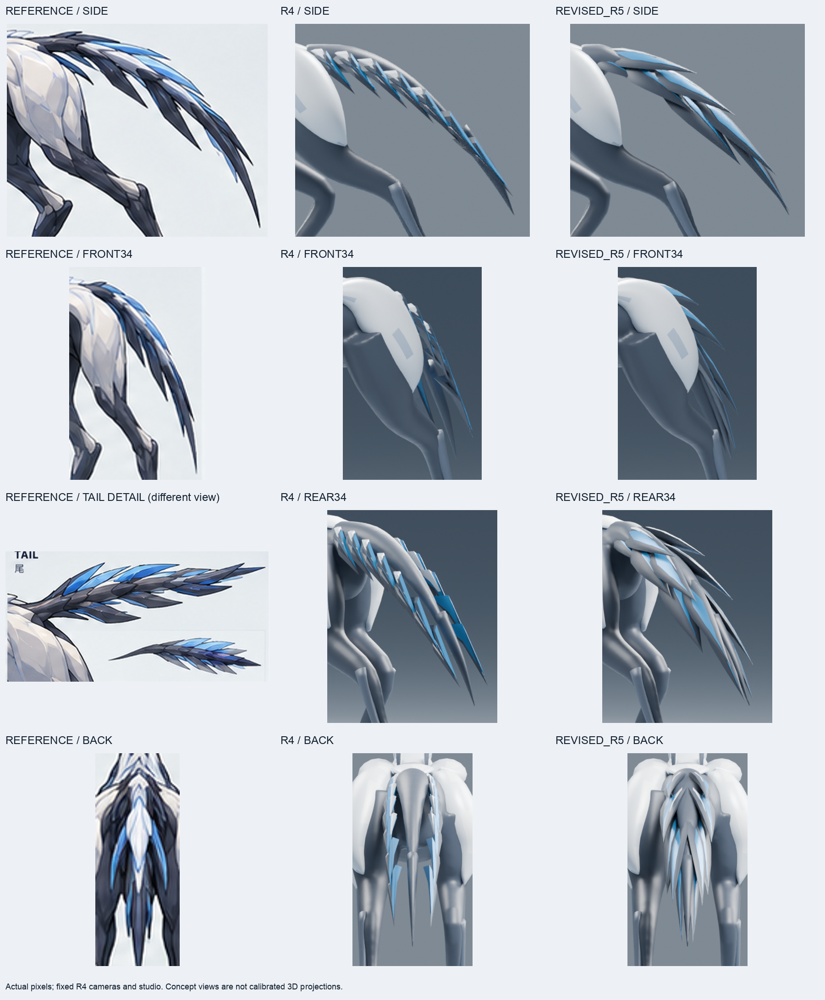

# S ZERO R5 尾の実造形・品質評価 — 2026-10-20

**判定: REVISE。尾の局所改善を継続用R5として保存。本番KEEPではない。**

[S_ZERO_CANDIDATE_REVISED_R5.blend](S_ZERO_CANDIDATE_REVISED_R5.blend)は、R4の同一バイトの作業コピーをBlender **4.3.2**で開き、Blender MCPを通じて既存メッシュを直接編集したモデル。
変更範囲は尾のみ。外部ドナー、全身生成器、画像生成は使用していない。

## 再開と保護

- worktree: `/Users/lyla/evowild-s-zero-20261017`
- branch: `exp/s-fullbody-zero-verify-20261017`
- 開始HEADとfetch後の`FETCH_HEAD`: **`b305613190a60e2d851b8599a95b7d4aafbc31e1`**。差分0 / 0。
- 既存325成果物のSHA256を記録し、終了時に照合。未commitの`27_publish_r3_git_objects.py`と`R3_GIT_OBJECT_UPLOAD.json`は一時領域にも保護し、今回のcommit対象から除外。
- R4を`verification/S_ZERO_R5_WORKING_COPY.blend`へ同一バイトでコピー。R4以前、基準PNG、mainは変更していない。
- Blender MCPは接続済み、初期シーンは未保存変更なし。Blender 4.3.2 / addon 1.8 / protocol 13を確認。
- sandbox内の独立BlenderはMetal初期化中に終了139。許可された制限外実行で復旧し、実レンダリングを完了した。ライブMCPの編集セッションは維持。
- `git reset --hard`、`git clean`、force pushは使用していない。

[開始記録](evidence/R5_RECOVERY_START.json) / [R4読込記録](evidence/R5_OPENED_R4.json)

## 基準と実編集

最上位基準は[00_s_type_modeling_image_v1.png](../references/00_s_type_modeling_image_v1.png)。共通原画、creature reference index、S handoff、correction lockも参照した。sparse checkoutで未展開の資料は`git show HEAD:...`で読んだ。

R4の5方向画像と原画を確認したうえで、既存の尾39メッシュと、連続本体の尾に限った**1,920頂点**を編集した。

| 問題 | R5で行った実編集 | 残る不一致 |
| --- | --- | --- |
| 中央が棒状 | 既存本体の尾頂点を局所変形。根元から減衰させて側面から見える上下の厚みを抑え、横幅を少し増やす。上面を層で覆い、長い円柱のハイライトを減らした | 付け根の丸い盛り上がりが残る。原画の面でつながる移行には未到達 |
| 同じ薄板の繰り返し | 既存7組を厚みのあるレンズ断面へ局所再構成。上側の長い層と下側へ抜ける層で長さ・幅・方向を変えた | 左右の対称性と山形の並びがまだ規則的。原画の複雑な重なりと稜線が不足 |
| 根元・各層の接続 | 主層の始点を中央部に埋め込み、根元から重なる体積を確保。末端側2組は検査結果から位置を再修正 | 別メッシュの体積的な重なりであり、全体が溶接された連続トポロジーではない |
| 先端の厚み | 各層は中腹に体積を持たせて先端へ絞る。既存`TAIL_TIP`は頂点・面数を保持し、丸い断面を扁平にして層へ収めた | 先端の流れが直線的。原画の細い曲がりと層ごとの終わり方には差がある |
| 色の面 | 既存の青・白メッシュを暗い主層の実三角面に沿わせた薄い閉じた面へ再構成 | 材質はR4を維持。原画の暗い面・青い面・白い稜線の配置は完全一致ではない |

残る**104メッシュ**はR4と一致。冠、頭部、Cue Band、肩、胸、胴、骨盤、四肢、足を保護した。
連続本体の尾以外の25,647頂点、全身の既存オブジェクト、材質スロット、材質設定、カメラ、照明、色管理は維持。
本体の面接続・材質割当・シェーディングは変更していない。尾39メッシュは同じオブジェクトとメッシュデータを直接編集した。

## 試作判断

1. **Aは不採用**。層が同じ方向に重なり、SIDEで一枚の刃に見えた。色の面が元の面の折れをまたいで欠けた。
2. **Bは要修正**。上・下の層に違いをつけ、色の面を実三角面に沿わせた。形状は改善したが、末端側4個の根元中心が中央部の外側にあった。
3. **Cを継続用R5に採用**。末端側2組の根元を中央部へ寄せた。14個すべての根元中心が内側となり、4方向の実画像で再確認した。

[A比較](comparisons/R5_TRIAL_A_TAIL_COMPARISON.png) / [B比較](comparisons/R5_TRIAL_B_TAIL_COMPARISON.png) / [C比較](comparisons/R5_TRIAL_C_TAIL_COMPARISON.png) / [判断記録](evidence/SCULPT_R5_REVIEW.json)

## 保存・5方向検証

R5を別名保存し、ライブBlenderと独立プロセスで再読込。保存済みR5から5方向を新規レンダリングした。

| 方向 | 厳格評価 |
| --- | --- |
| [SIDE](renders/revised_r5/SIDE.png) | 中央棒と均一な薄板の印象は減った。根元の丸い膨らみ、層の単純な輪郭は残る |
| [FRONT](renders/revised_r5/FRONT.png) | 全身のS形態・Cue Bandを維持。尾は身体の奥に重なるため、この角度だけでは尾の品質を判定しない |
| [FRONT34](renders/revised_r5/FRONT34.png) | 浮いた小片が減り、尾として流れがつながる。層の広がりと先端の曲がりは原画に不足 |
| [REAR34](renders/revised_r5/REAR34.png) | 層の体積と根元からの重なりを確認。滑らかな明るい面が多く、原画の暗い面割りと異なる |
| [BACK](renders/revised_r5/BACK.png) | 中央の露出が減り、重なる尾の塊となる。山形の反復と白・青の配置は未一致 |

[5方向一覧](comparisons/REVISED_R5_FIVE_VIEWS.png) / [原画・R4・R5全身比較](comparisons/REVISED_R5_REFERENCE_R4_COMPARISON.png) / [R4/R5 5方向](comparisons/REVISED_R5_R4_FIVE_VIEW_COMPARISON.png) / [静止128px](comparisons/REVISED_R5_STATIC_128PX.png)

Cycles CPU / **32 samples / seed 17 / 1200×900**。R4と同じカメラ行列・orthographic scale・照明・材質・色管理を使用。
比較画像は実画素の切抜き・等比リサイズ・配置・文字のみ。原画のカメラと姿勢はモデルと完全一致しない。
原画にREAR34の同一投影はないため、比較板の該当欄には尾の詳細図と明記した。

MCPの実ビューポート: [SIDE](renders/revised_r5_viewport/SIDE.png) / [FRONT34](renders/revised_r5_viewport/FRONT34.png) / [REAR34](renders/revised_r5_viewport/REAR34.png) / [BACK](renders/revised_r5_viewport/BACK.png)。
solid material / studio cavity表示であり、Cyclesとは照明表示が異なる。

- R5: **1,304,535 bytes**、SHA256 **`87fd6732a682ece45733e1c9ad78861a6b2543259c5feae38ba506fe6a509923`**。
- R4保持: **`8533fc33a2d43d498618a5f449b675a25bf7d7126d72eee3b936db843f0c11ad`**。
- 再読込: **144 meshes / 42,455 vertices / 45,064 faces**。
- 全メッシュの境界辺・非多様体辺・孤立頂点・面積1e-12未満の面は0。
- 尾39メッシュの非隣接面BVH自己交差候補は0。各主層の根元中心は最近傍面の法線による内外判定で中央部の内側。これは完全な交差証明や溶接接合の証明ではない。
- 採用Cと保存後R5のSIDE / FRONT34 / REAR34 / BACKはRGB画素一致を照合。

[最終再読込](evidence/VERIFY_S_ZERO_CANDIDATE_REVISED_R5_RELOAD.json) / [保存記録](evidence/R5_SAVE.json) / [最終照合](evidence/R5_FINAL_LOCAL_CHECKS.json)

**全身・尾ともREVISEを維持。Armature / Actionなし。歩様、リギング可能性、PC/mobile runtimeは未検証。本番差替え・昇格は行っていない。**
静止128pxは形態の補助確認であり、実レース画面や動作検証の代わりにはならない。

## 再現とGitHub

新しい出力先でR4を同一バイトの作業コピーにし、[41_inspect_r5.py](scripts/41_inspect_r5.py)をBlender MCPから実行。
[42_sculpt_r5_tail.py](scripts/42_sculpt_r5_tail.py)の`EVOWILD_R5_TRIAL`にA / B / Cを指定して実編集する。
[44_verify_r5.py](scripts/44_verify_r5.py)で再読込検査し、実画像の評価後に[45_save_reviewed_r5.py](scripts/45_save_reviewed_r5.py)でR5を保存。
[05_review_render.py](scripts/05_review_render.py)、[43_compare_r5.py](scripts/43_compare_r5.py)、[47_finalize_r5_evidence.py](scripts/47_finalize_r5_evidence.py)で画像と照合記録を作る。既存出力の上書きは拒否する。

送信先は[保全branch](https://github.com/badjoke-lab/evowild-test/tree/exp/s-fullbody-zero-verify-20261017/art/s-creature/zero-rebuild-20261017)。
[48_publish_r5_git_objects.py](scripts/48_publish_r5_git_objects.py)は通常pushの通信失敗時に既存の小分けGitHub API経路を再利用する。`force=false`と事前HEAD照合を必須とする。
モデル・レンダリング・比較画像・制作スクリプト・品質評価をGitHubから再取得し、[49_verify_remote_r5.py](scripts/49_verify_remote_r5.py)でバイト照合する。
照合結果は[REMOTE_R5_FINAL_VERIFY.json](evidence/REMOTE_R5_FINAL_VERIFY.json)に記録する。
