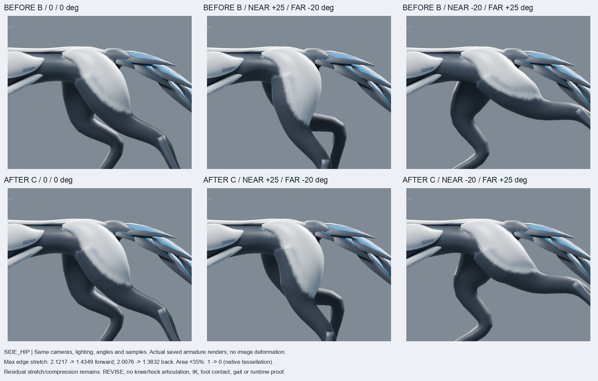
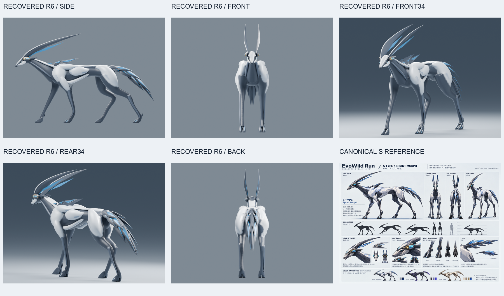

# R6復旧・股関節修正の品質評価 — 2026-10-20

**総合判定: REVISE。静止形状と3姿勢の変形を別々に評価し、継続用R6として保存。完全な変形品質の合格、本番KEEPではない。**

正式モデル: [S_ZERO_CANDIDATE_REVISED_R6.blend](S_ZERO_CANDIDATE_REVISED_R6.blend)  
分離した検証リグ: [S_ZERO_R6_HIP_DEFORMATION_RECOVERED_C.blend](verification/S_ZERO_R6_HIP_DEFORMATION_RECOVERED_C.blend)

## 復旧元と保護

開始HEADは指定された `b1dfb110c342d161c0d315724dff1d8f0e5b6389`。SSH 443でfetchしたリモート履歴との差分は0 / 0。

前回の[試作B](../verification/S_ZERO_R6_TRIAL_B.blend)を同一バイトで保護コピーし、Blender **4.3.2** / MCPで読み込んで継続した。新規全身生成、別モデルへの置換は行っていない。

- 試作B SHA256: `8748d32c0b842c15c5a3c5da910637b4dcc06bf8af112882c2447afdb47e4949`
- 旧検証B SHA256: `a5bbee954a0ab43bc00eea73293492c690f9e5240f1e3730f16e556ea8115047`
- 作業開始時の既存463ファイルをハッシュ記録。R6関連62ファイルは別の一時領域にもコピー。
- 前回のルート直下 `S_ZERO_CANDIDATE_REVISED_R6.blend` も発見したため保持。今回の正式モデルは **`r6-recovery-20261020/`内の同名ファイル**。
- R5、試作A/B、旧リグ、旧画像、スクリプト、ログは上書きしない。

[開始保護記録](evidence/RECOVERY_PROTECTED_FILES.json) / [最終保護照合](evidence/FINAL_LOCAL_CHECKS.json)

最上位基準は[00_s_type_modeling_image_v1.png](../../references/00_s_type_modeling_image_v1.png)。共通原画、reference index、S modeling handoff、correction lockも読んだ。sparse checkoutにない資料は`git show HEAD:...`で取得。

MCPのaddon protocolは13、サーバー期待値は14だが、接続・実編集・再読込・実ビューポート表示は動作した。環境更新は行わない。サンドボックス内の独立Blender起動は終了139となり、許可された制限外実行でCyclesレンダリングを完了。

## 実際に修正した内容

| 箇所 | 修正 | 保持したもの |
| --- | --- | --- |
| 骨盤と大腿の連続面 | 既存の接続部8,388ポリゴンをBlender BMeshで明示的に三角分割。暗黙の分割で生じていた細すぎる三角形と不安定な対角線を修正 | Bの溶接済み本体、白い骨盤面、すべての元頂点位置 |
| 内股・尾根元のウェイト境界 | 座標式の急な切替を廃し、メッシュ接続に沿った正の重み付きラプラシアンで連続ウェイトを求めた。胴体・尾を固定し、遠位後肢を各脚100%とする境界条件 | 3ボーン、正規化、dual-quaternionの体積保持。外見ドナーなし |
| 回転中心 | 手前を `(0.78,-0.235,1.74)` → `(0.80,-0.29,1.62)`、奥を `(0.67,0.235,1.70)` → `(0.70,0.29,1.62)`。骨盤と上腿の接続内へ下げて比較 | 世界Y軸回転、元と同じ前方25°／後方20° |
| 変形遷移 | 3種類の境界位置×2種類の回転中心、計6条件を実評価。採用は遠位固定境界z=1.24、上部固定境界z=1.96、未知頂点5,989 | 膝・足首の曲げ、IK、地面接触は追加していない |

全27,724本体頂点の座標、保護対象140メッシュ、骨盤外19,626面の座標・材質割当・コーナー色が試作Bと一致。冠・肩・尾・足先を含むR5保護領域、元の材質設定、スタジオ、カメラも既存の再読込検証で照合した。

今回の静止形状はBの輪郭を維持している。**新しいシルエット改善を主張しない。** R5からBで得た骨盤の一体化を維持し、今回は面構成と変形を改善した。原画の面の折れ、白黒境界の精度、上腿の丸さには課題が残る。

[制作・6条件の測定記録](evidence/R6_REPAIR_AND_DEFORMATION_C.json) / [制作スクリプト](scripts/58_repair_r6.py)

## 実変形の数値

旧Bリグと復旧Cリグを、それぞれ保存済みファイルから再読込した。手前前方時には奥を後方、手前後方時には奥を前方とする。角度を小さくして改善を作っていない。

| 姿勢（手前 / 奥） | 最大辺伸長 B → C | 最小辺長比 B → C | 最小三角面積比 B → C | 面積35%未満 B → C |
| --- | ---: | ---: | ---: | ---: |
| 中立 0° / 0° | 1.0000 → 1.0000 | 1.0000 → 1.0000 | 1.0000 → 1.0000 | 0 → 0 |
| 前方 +25° / −20° | **2.1217 → 1.4349** | 0.4276 → 0.7448 | 0.5052 → 0.7404 | 0 → 0 |
| 後方 −20° / +25° | **2.0076 → 1.3832** | 0.3550 → 0.6638 | 0.1498 → 0.5367 | **1 → 0** |

上表の面積は各モデル固有の三角分割による値。Bの極小三角形4枚は旧試験と同じ外積長1e-9未満の基準で除外して再現している。Cでは除外0枚。

面割り変更の影響を隠さないため、**元Bと同じ15,819辺**、さらに**同じC三角分割**でも旧／新変形を測定した。

| 同一面割りでの比較 | B変形 | C変形 |
| --- | ---: | ---: |
| 前方の最小面積比 | 0.5343 | 0.7404 |
| 後方の最小面積比 | 0.5003 | 0.5367 |

したがって、後方の極端な潰れの改善は**面割り修正が大きく寄与**している。ウェイト・回転中心だけで0.1498→0.5367になったとは扱わない。同じ元辺での最大伸長は上表と同じ改善値。全身を対象に広げた検査でも最大伸長・最小面積比は同じであり、問題を股関節の検査範囲外に移していない。

Cの全3姿勢で次を確認:

- 1.5倍超の辺0（Bは前方107、後方88）。
- 面積35%未満0、面積2倍超0、静止法線との内積が負の三角形0。
- 境界辺0、非多様体辺0、ゼロ面積ポリゴン0。
- 全身および股関節の非隣接面BVH交差候補0。
- 固定頂点の最大移動0。

**最大43.49%の伸長、後方で最小面積53.67%までの圧縮は残る。変形問題の完全解消とは判定しない。** BVH候補0は厳密な自己交差証明ではなく、法線内積も診断値である。3姿勢以外の補間全フレーム、走行歩様、膝・足首、接地、PC/mobile runtimeは未検証。

[独立再読込と共通面割り・全身検査](evidence/INDEPENDENT_SAVED_DEFORMATION.json) / [検証スクリプト](scripts/62_verify_saved_deformation.py)

## 実画像

- [全身SIDE・3姿勢の前後](comparisons/HIP_BEFORE_AFTER_SIDE.png)
- [REAR34・3姿勢の前後](comparisons/HIP_BEFORE_AFTER_REAR34_HIP.png)
- [BACK・3姿勢の前後](comparisons/HIP_BEFORE_AFTER_BACK_HIP.png)
- [未加工の復旧リグ画像12枚](renders/hip_recovered_c)
- [未加工の旧Bリグ画像12枚](../renders/r6_hip_test_b)

同じカメラ行列、投影、照明、Cycles CPU、24 samples、seed 17、960×800。床は両版とも非表示で、足の接地検証には使用しない。画像の変形・補間・描き足しはない。比較板は実画素の等比リサイズと配置・ラベルのみ。

## 静止5方向の評価

| 方向 | 評価 |
| --- | --- |
| SIDE | Bの白い骨盤面と連続した上腿を維持。腰の接続は保たれる。白黒境界は柔らかく、原画の鋭い面構成には不足 |
| FRONT | Sの細身の姿、冠、Cue Bandを維持。後肢接続は前肢に隠れるため、この角度だけで品質を判断しない |
| FRONT34 | 胴から骨盤へのつながりを維持。大きな白面と丸みは残る |
| REAR34 | 骨盤・大腿の連続面を確認。尾のR5形状を保持。面の折れと白黒境界は追加修正が必要 |
| BACK | 左右後肢と尾を保持。白面の下端と内股の面構成は原画への一致が不十分 |

[原画・R5・R6の5方向比較](comparisons/REFERENCE_R5_R6_FIVE_VIEW_COMPARISON.png) / [静止128px](comparisons/R6_STATIC_128PX.png)

原画はモデルと姿勢・投影が異なり、REAR34の同一原画はない。比較欄のBACKは文脈用と明記。128px静止画像は実レース画面の動作確認を代替しない。

正式ファイルの再読込からCycles CPU / 32 samples / seed 17 / 1200×900で5方向をレンダリング。R5のカメラ・照明・色管理を保持。

## 保存判定

- **静止形状: REVISE**。R5に対する骨盤連続化の改善を保持し、内部面割りを修正。Bの全頂点位置は不変。継続候補として採用。
- **変形品質: REVISE**。2.12倍伸長と極端な局所潰れは改善。残る伸長・圧縮と未実施試験のため品質合格にはしない。
- **本番昇格: しない**。KEEP記録、実歩様、PC/mobile runtimeのゲートを満たしていない。

正式モデルは141メッシュ、41,790頂点、51,776面。本体は27,724頂点・34,464面の1接続成分。静止時の非多様体・境界・孤立頂点・退化面0。暗黙分割で面積1e-9未満だった三角形は5→0。

正式モデルにArmature、Action、頂点グループ、Armature modifierは0。検証リグを不用意に混入させていない。

正式R6 SHA256: `efee1aab704c16fcdfcf09cd7b309aae4ae3cb8f5f584689b51847b7f285b15a`（1,472,522 bytes）。

[保存記録](evidence/R6_RECOVERED_SAVE.json) / [R5保護領域と構造の再読込検査](../evidence/VERIFY_R6_RECOVERED_C_RELOAD.json) / [5方向の出力記録](evidence/RENDER_revised_r6.json) / [3姿勢の出力記録](evidence/RENDER_hip_recovered_c.json)

## GitHub保存と再取得

対象branch: `exp/s-fullbody-zero-verify-20261017`  
送信先: `ssh://git@ssh.github.com:443/badjoke-lab/evowild-test.git`

既存HEADから通常commit・通常pushする。force push、`git reset --hard`、`git clean`は使用しない。前回未送信のR6試作・検証・制作スクリプトも保存対象。無関係なR3/R5の未追跡ログ・スクリプトは対象外。

[成果物manifest](evidence/R6_DELIVERY_MANIFEST.json)を用い、[再取得スクリプト](scripts/64_verify_remote_ssh.py)がローカルobject storeを共有しない新しいGitリポジトリへSSH 443でfetchし、実ファイルをcheckoutして全バイトを照合する。
再取得結果は別の保存確認commitで追加する。
