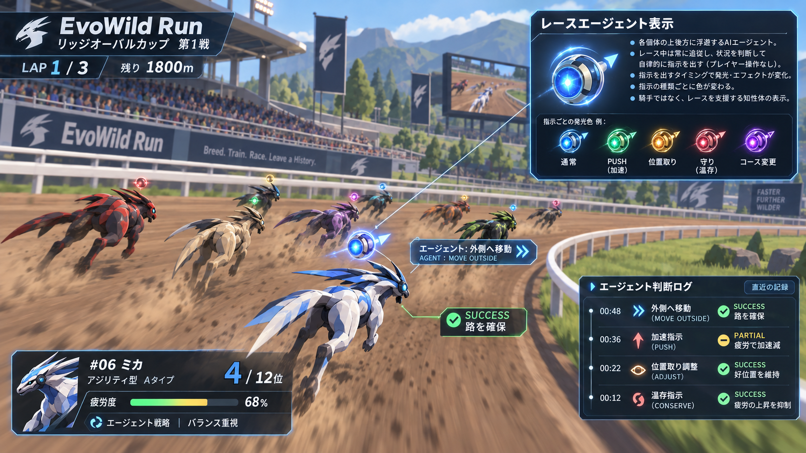
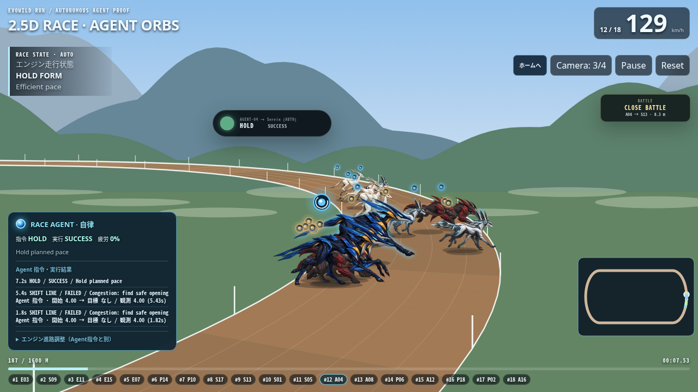
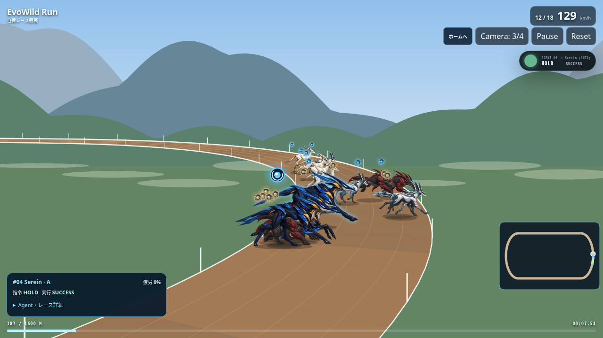
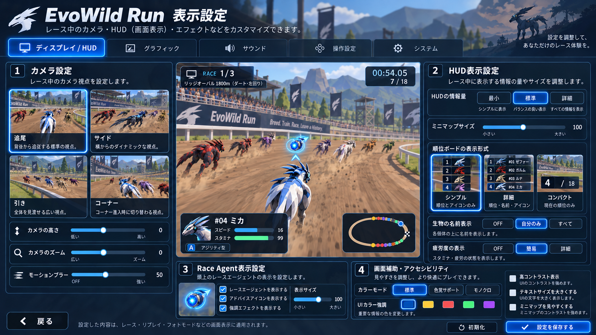
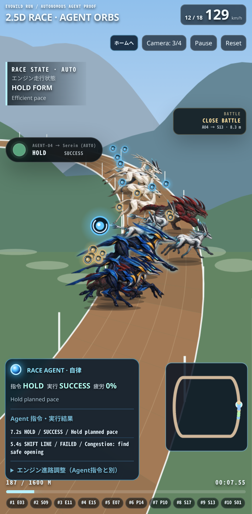
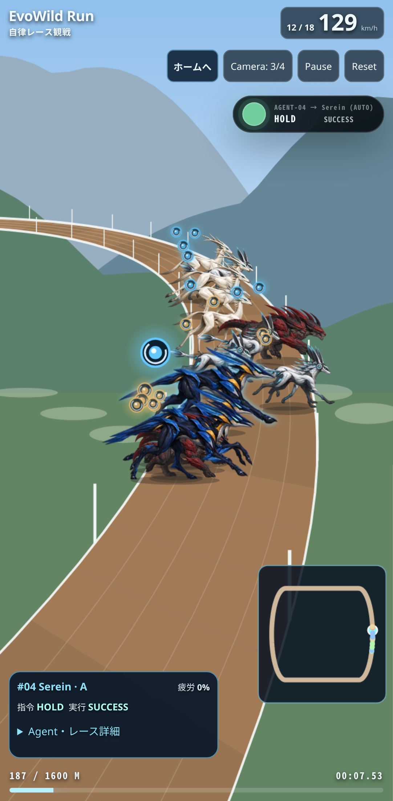

# Spectator HUD: first bounded visual improvement — 2026-10-25

Baseline: `688e3a9`, PR #132. **Overall visual judgment: REVISE. No Creature asset is promoted.** Original mocks and canonical artwork are unchanged; all 11 original SHA-256 checks passed before this UI work.

## Actual browser comparisons

Normal 18-runner race, selected #04 Serein, unchanged balanced Agent, chase camera. Desktop Chromium 1280×720 and Pixel 7 Chromium emulation 412×839. Same controlled-clock sequence before/after: start at 2.6s after start click, first corner at 6s, pack/overtaking at 10s, back straight at 19s. Observed race distances are approximately 0m / 70m / 187m / 500m; exact positions, draw counts and HUD bounds are in each `observations.json`. Small frame-alignment differences are recorded, not concealed. No fixture results, full-race rerun or new mock imagery.

| Phase | PC before | PC after | Android before | Android after |
| --- | --- | --- | --- | --- |
| Start | [Before](before-desktop/start.png) | [After](after-desktop/start.png) | [Before](before-android/start.png) | [After](after-android/start.png) |
| First corner | [Before](before-desktop/corner.png) | [After](after-desktop/corner.png) | [Before](before-android/corner.png) | [After](after-android/corner.png) |
| Pack / passing | [Before](before-desktop/pack.png) | [After](after-desktop/pack.png) | [Before](before-android/pack.png) | [After](after-android/pack.png) |
| Back straight | [Before](before-desktop/straight.png) | [After](after-desktop/straight.png) | [Before](before-android/straight.png) | [After](after-android/straight.png) |

| Original reference | Actual before | Actual after |
| --- | --- | --- |
|  |  |  |
|  |  |  |

## What changed

- Essential HUD always shows rank, selected name/morph, fatigue, Agent command and actual execution result. The engine state, battle details, Agent/engine logs and all-runner ranking move into a native, keyboard-operable disclosure. Escape closes it and returns focus; reset closes it. Opening details does not alter race state or issue a command.
- Smaller title, speed readout and controls leave the center clear. Transient execution feedback moves to the upper edge. World-following canvas orbs are unchanged; the removed decorative HUD orb was not a runner's orb.
- Agent panel height in pack/straight: **PC 255.4 → 94px; Pixel 7 198.6 → 91px**. Selected Creature anchor and orb stay outside the collapsed panel at all four sampled phases. A 320px width check passes. Detailed information remains available on request.

## A / B findings and remaining work

- **Creature overlap remains REVISE.** Rendering already sorts far-to-near by projected depth and uses actual distance/lane. The camera follows from 54 world units behind, 13 laterally and height 17. The side-facing source silhouettes still overlap heavily in the pack. Start offsets fade out by 2.4 race seconds; this unit does not alter that behavior. Sprite scale, projection, drawing order, camera, physics, lane choice, speed and collision logic are unchanged.
- **Orb association remains REVISE.** The renderer invokes one orb draw for each rendered runner using that runner's projected position, sprite bounds and Agent state. Counts are 18/18 through the opening corner/pack and 16/16 at the back straight. These are render-list counts, not proof that every sprite is fully visible; clipping/culling and overlapping silhouettes still need work. The selected larger orb follows its Creature in every sample, but other small orbs can be confused amid overlapping bodies. No new stable identity marker/tether is implemented in this HUD-only unit.
- **Mock 01 gap:** rear-angle locomotion, individual spacing/readability, stadium detail and per-runner command/result identification remain incomplete. No rotation/warping of the six-frame sheets was used.
- **Mock 06 gap:** compact essential information and optional detail now exist, but the full display-settings interface is not implemented. The existing minimap is unchanged. No mock sample numbers or unapproved settings became game rules.
- **KEEP/REVISE:** retain this tested HUD behavior for review; **visual gate remains REVISE**, pending user review and further render/orb improvements. Test success is not visual acceptance. Physical Android hardware was not tested.

## Verification

- Production build PASS (`build.log`).
- 24 relevant cases: initial run 23 pass / 1 selector failure (`initial-tests.log`). A later HOLD could replace SHIFT_LINE as the newest row; the lane-arrival test now selects the actual SHIFT_LINE record without removing any arrival/result assertion. Both affected browser cases then passed (`selector-tests.log`). All 24 unique targeted cases now pass across these runs.
- New HUD tests cover all four phases, name/rank/fatigue/Agent visibility, compact panel bounds, orb/runner counts, optional details, keyboard close/focus, 320px overflow and reset. Existing disclosure tests explicitly open the new detail control before asserting visibility.
- Baseline Actions [40186097985](https://github.com/badjoke-lab/evowild-test/actions/runs/40186097985): build PASS, **101 passed / 2 known failed / 81 skipped**. Failures are Android and desktop `race-quality.spec.js:47` PUSH comparison. Prior full-journey duplicate-selector regression is fixed. Current-source Actions will be recorded separately; no claim of a green full suite.

## Next bounded unit

Use these pack/straight captures to evaluate **render-only** camera framing and sprite-size caps in `oval_course_2p5d.js` / `oval_render_2p5d.js`. Quantify on-screen runner/orb bounds and overlap before changing one projection/scale parameter. Keep actual simulation state and canonical sprites unchanged. Then add per-runner orb identity/anchor evidence as a separate unit. Do not restart imports, Agent logging, completed race flow or these HUD changes.
