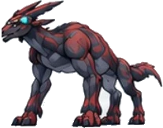
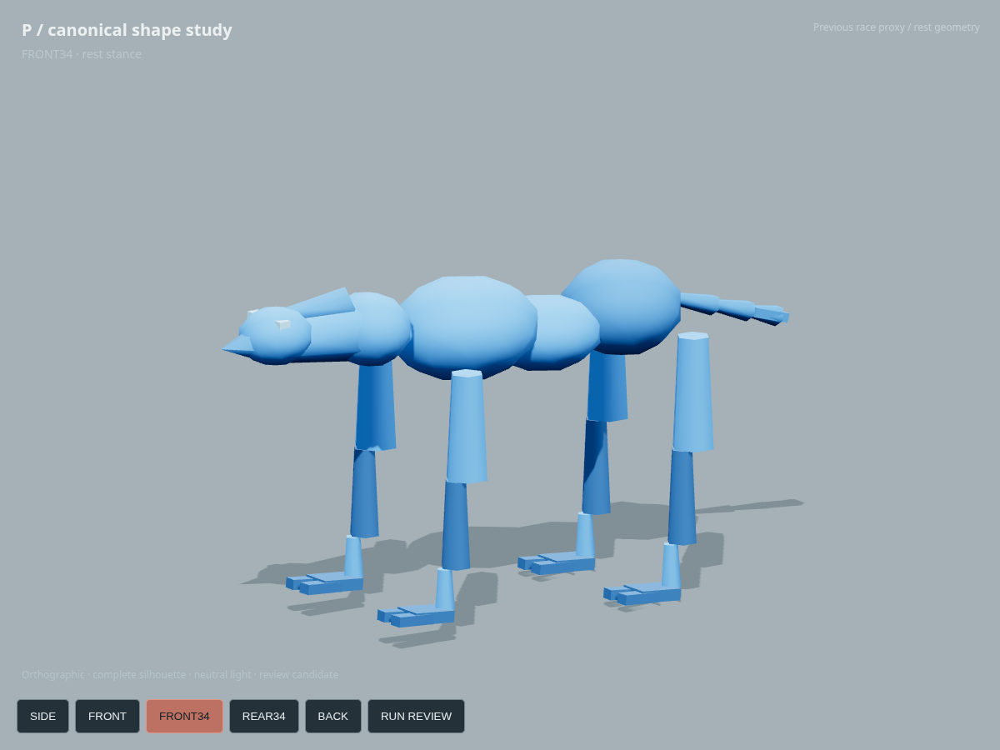
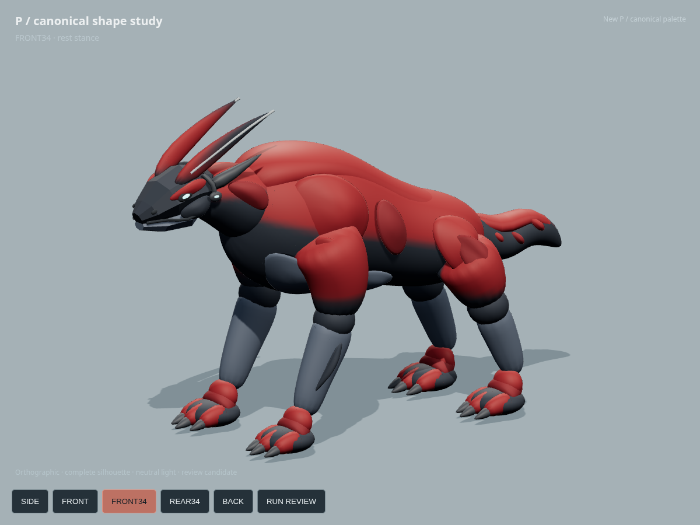
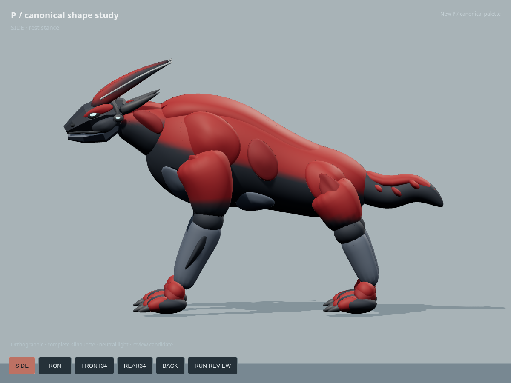
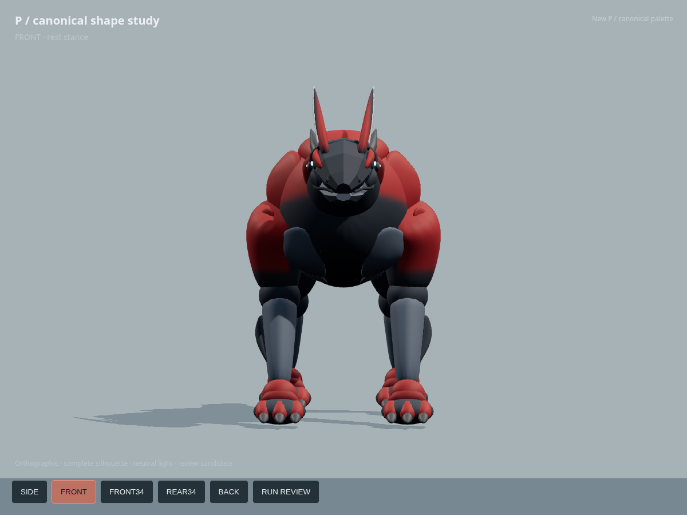
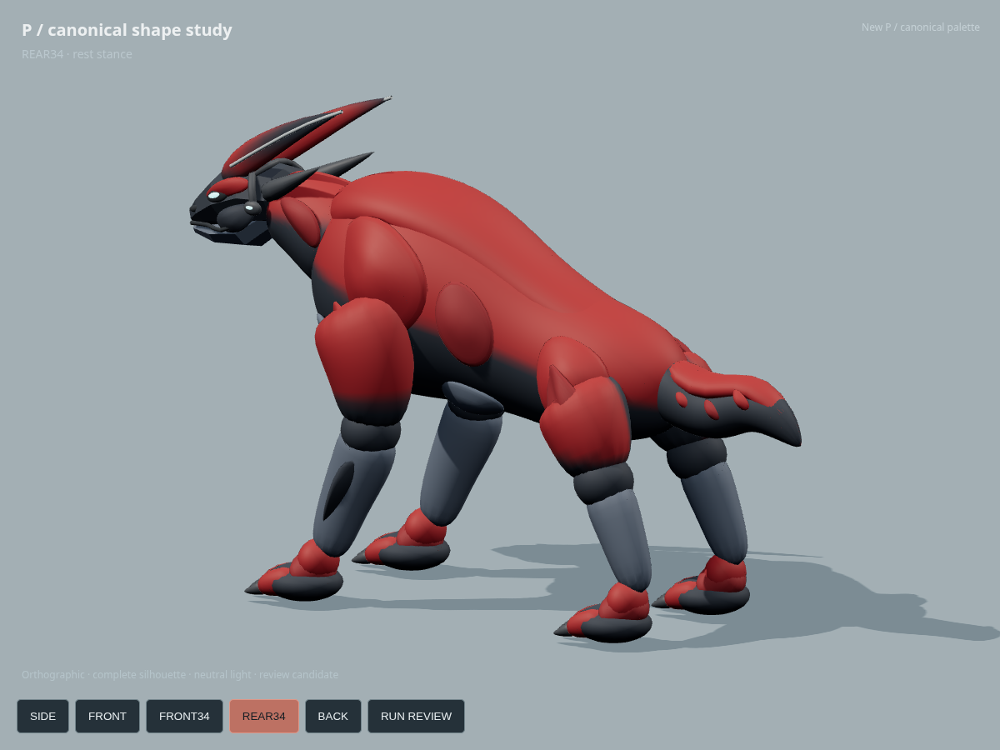
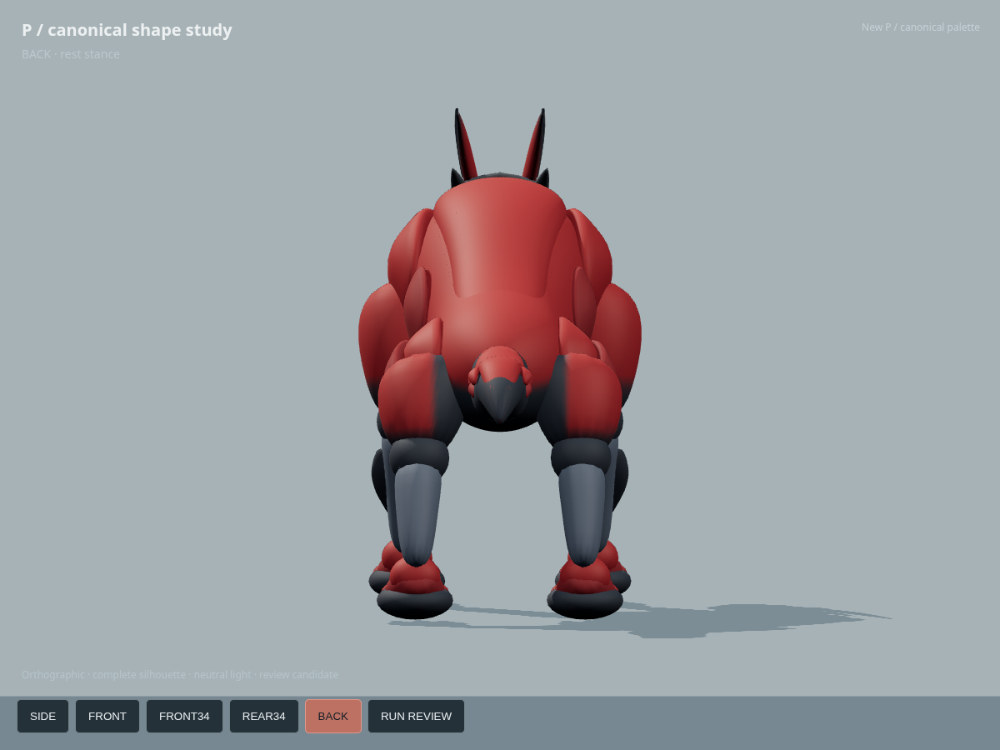
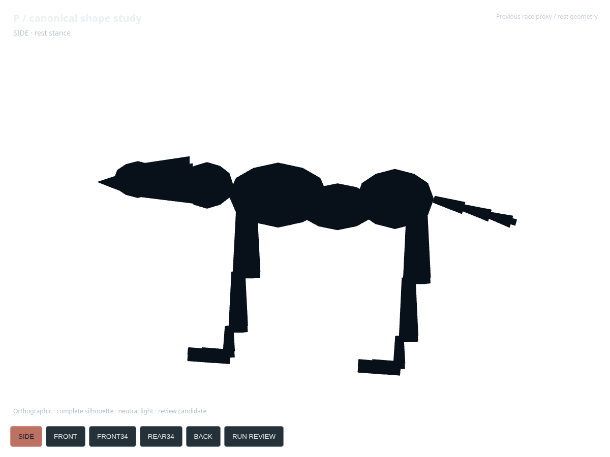
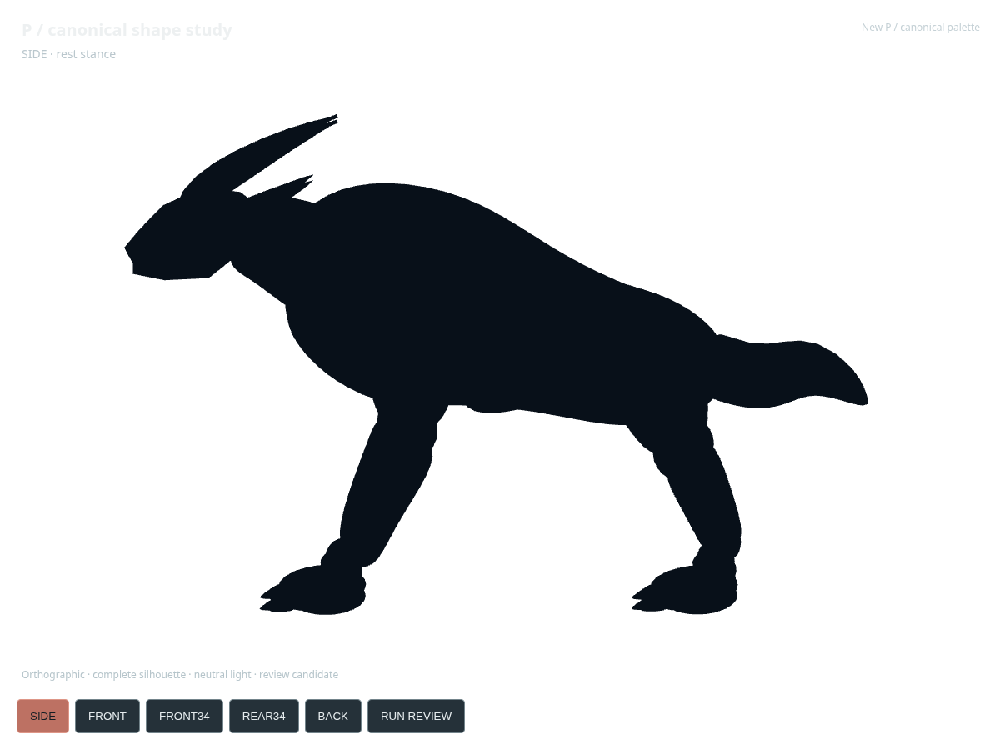

# Canonical P — 3D shape comparison, 2026-10-11

**The new asset is visibly closer to canonical P than the previous blue race proxy.** This is a new modeled surface and skeleton, not a recolor, contact-code fix, or promotion of the old proxy. The improvement is strongest in the heavy anterior mass, short thick neck, swept head silhouette, broad clawed feet, and short heavy tail. It is **not yet a final canonical-quality sculpt**: the smooth shoulders, round joint transitions, broad planar muzzle and inferred rear anatomy remain visible limitations.

Decision: **KEEP as a review/modeling candidate; HOLD production promotion.** Shape is sufficiently improved to justify the included minimal running study. This is not an approval of final shape, production gait, or race contact. No human approval is implied. The existing motion-first race implementation and main branch are unchanged.

## Reference, previous P, new P

| Canonical P (unaltered source) | Previous race proxy (actual geometry, rest stance) | New P (shipped GLB, rest stance) |
|---|---|---|
|  |  |  |

[Large comparison sheet](comparison.png) · [Comparison page](comparison.html) · [Full canonical sheet](../../references/evowild-creature-reference-sheet-20260921.jpg)


`P.webp` is only 207×163 px; the supplied sheet is 516×540 px. These are the unchanged source images, not regenerated references. There is no canonical P front/back turnaround. Unseen anatomy is therefore a restrained interpretation of the same P body, not a claim of exact multiview reconstruction.

## What changed by body part

| Part | Previous simplified race P | New modeled P | Remaining mismatch |
|---|---|---|---|
| Chest / shoulder | Separate low-poly balls; small chest depth | Continuous deep thorax, high shoulder arch, convex scapular masses, split ventral planes | Still too smooth/barrel-like; the reference has sharper interlocking masses and a more compact impression |
| Neck | Long horizontal cylinder and collar ball | Short, thick oblique neck entering the chest | Connection remains visibly segmented in some lighting |
| Head / jaw | Ball and cone muzzle | Small wedge skull, distinct lower jaw, cheek, mouth seam and nostrils | Muzzle planes are coarse and broader/cleaner than the intricate canonical face |
| Crest | One simple rear cylinder | Rooted paired swept blades, smaller lateral sweep, dark sides and restrained edge | Pair spacing and thickness are inferred; front view reads more like separated blades than the reference image establishes |
| Eyes / Cue Band | No anatomical eyes; rectangular cue bar | Small cyan eye slits and fitted graphite bridge/side signal device | Device is clearest from front/side; back silhouette only partially exposes it |
| Forelimbs | Thin straight tapering cylinders | Heavy upper arms, tapered slate forearms, defined wrist transition | Round elbows and rigid component weighting remain mechanical during flexion |
| Hind limbs / pelvis | Pelvis ball and narrow rods | Broad haunches, short stout shin/hock chain and planted palms | Reference joint angles and rear pelvic topology remain uncertain; joints need sculpt blending |
| Feet | Two flat rectangular toes | Broad palms, three distinct red digits and tapered graphite claws | Digit/sole forms are still smooth and evenly spaced |
| Tail | Thin stick chain and small box tip | Short thick, bent/tapered tail with red upper surface and overlapping folds | Fold rhythm and silhouette are approximate; the tip is smoother than canonical |
| Palette / surface | Uniform blue identification colour | Oxblood dorsal/limb surfaces, charcoal joints, slate ventral planes, cyan accents | Red is cleaner/brighter under neutral review lights; painted reference has more irregular dark patterning |

## Five-view shape review

All five images are **actual Three.js renders of `public/models/evowild-p/p-canonical-v1.glb`** at 1200×900, orthographic projection, identical lighting, rest pose. No generated 2D substitute, retouching, depth trick, or per-view model is used. The entire creature is framed in each view.

| SIDE | FRONT | FRONT34 |
|---|---|---|
|  |  |  |

| REAR34 | BACK |
|---|---|
|  |  |

The [previous rest proxy](previous-proxy.glb) is reconstructed directly from `createPowerCreature`, `createSimplifiedRaceProxy`, `RACE_PROXY_PROFILE` and the shared instance geometries in current `public/preview-motion-first/main.js` at base `cde1bd7c8a26637d587aafd6d1d8cc4da8fb0315`. It is grounded and rotated to the same forward axis, without nonuniform scaling. It is a rest geometry comparison, not a screenshot of its running pose. Both models use the same camera and light; the historical running screenshots below preserve what the prior race actually showed.

| Previous silhouette | New silhouette |
|---|---|
|  |  |

This silhouette comparison supports an actual mass/proportion improvement independent of red colour. At small display sizes the shoulder/crest/tail and broad feet remain distinct. Fine face and surface details disappear, as expected; 18-runner race readability/performance has not been approved.

## Existing October 10 evidence inspected

The requested `docs/evidence/gamestudio-3d-20261010/` lives on the experiment branch, not current main. Its README and isolated P SIDE/LOW captures were inspected from commit **`b4f8456d50eeb4072b0aa1cd528a646479298500`**. These two images are copied byte-for-byte for a durable comparison:

- [Actual previous race P, SIDE](previous-race-P-SIDE.png)
- [Actual previous race P, LOW](previous-race-P-LOW.png)

The old review itself explicitly did not approve canonical shape and identified simplified geometry and contact problems. The separate P contact branch `91d75134df80a01033def8fd61a0dc17634444af` was inspected for scope, but its contact changes were not used as evidence of modeling completion.

## Minimal running review

[Running review video](running-review.mp4) · [Eight-frame contact sheet](running-contact-sheet.png)

The **same new GLB** includes `P_Power_Run_Study_0p8s`, a 0.8-second / 25-keyframe cycle on 17 bones. Fore/hind phase offsets, a restrained chest load, a level palm orientation and limited recovery lift provide a minimal power-run study. It is an in-place animation, with no race simulation transplant.

The video uses **24 distinct browser-rendered frames per camera**, sampled at 30 fps; four repetitions of SIDE then four of FRONT34 make a 6.4-second inspection clip. This is deterministic pose evidence, **not a live FPS benchmark**. Source frames at 0, 0.2, 0.4, 0.6 seconds are retained for both cameras. The repeated cycle and camera cut are intentional.

`run-authoring-check.json` records zero unreachable stance IK targets. This metric does **not** prove rendered sole contact, friction, or race motion quality. The rigid component weights expose round joints and occasional surface intersections, and the rear-limb stride is deliberately short. Shoulder blending, muscle deformation, turn/bank behavior, long strides and race-level foot sliding still need work. Shape remains the reason to keep this candidate; these motion checks are not a substitute for it.

## Asset, runtime and validation

- Runtime asset: `public/models/evowild-p/p-canonical-v1.glb`; 56,104 triangles, 10 materials, 17 bones, no textures/external URIs; approximately 2.03 MB. A single skin uses material primitives. No decoder is required.
- Source: `scripts/modeling/build-canonical-p.py`, deterministic Blender 4.3.2 contour lofts, anatomical surface panels and vertex colours. No source/donor creature mesh or generative 3D service was used. No paid generation was run.
- Packaging: glTF Transform 4.3.0 `dedup` and `prune`; identity skin parent normalized to the scene root. Geometry was not decimated for this shape review. Collision and LODs are deferred because this is an isolated review, not race deployment.
- Viewer: `p-canonical-review.html` / `src/p-canonical-review.js`; built by Vite. Camera buttons and running/rest controls work. Uses installed Three.js, no remote CDN.
- [Browser validation](browser-validation.json): desktop 1200×900 and Pixel 7 **emulation**, model loaded, five views, animation, pause/rest restoration and controls checked; no page errors or failed requests. This is not an Android hardware test.
- [Mobile SIDE](mobile-SIDE.png), [mobile FRONT34](mobile-FRONT34.png), [mobile run](mobile-run.png).
- [Khronos glTF validation](gltf-validation.json): final result recorded without omitted issues.
- [Build/asset verification](verification.json) includes file hashes, reference preservation, build result and delivery scope. The source images and motion-first implementation were not edited.
- No 18-runner performance, production contact or final canonical KEEP claim is made.

## Reproduce

From the repository root, with Node dependencies, Blender 4.3 and Chromium installed:

```sh
blender -b -t 4 --python scripts/modeling/build-canonical-p.py -- --no-render
node scripts/modeling/finalize-p.mjs
node scripts/modeling/export-previous-p.mjs
npm run dev -- --host 127.0.0.1 --port 4173
# In another shell:
node scripts/modeling/capture-p-review.mjs
node scripts/modeling/package-p-evidence.mjs
```

`finalize-p.mjs` pins glTF Transform 4.3.0 and uses the local `work/npm-cache`. `CHROMIUM_PATH` can override `/usr/bin/chromium`. Blender renders, `.blend` working source and raw video frames stay under `work/`; the final review images are captured from the shipped GLB. Source code, manifest, final GLB, reviewed captures and this comparison are committed. The exact branch file inventory is [changed-files.txt](changed-files.txt).
