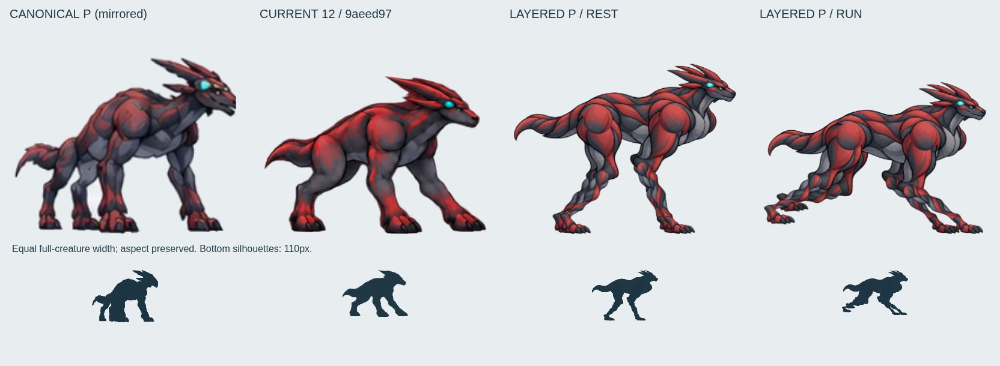
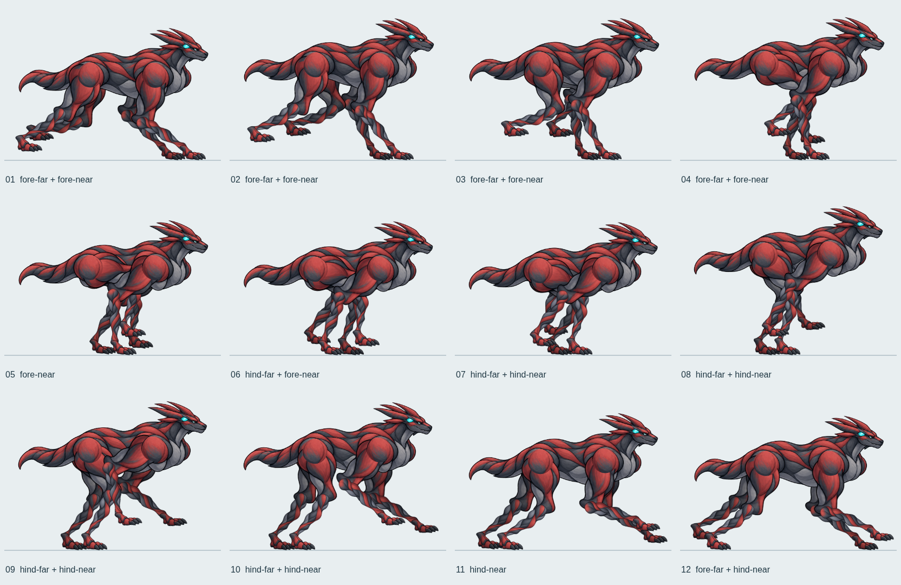
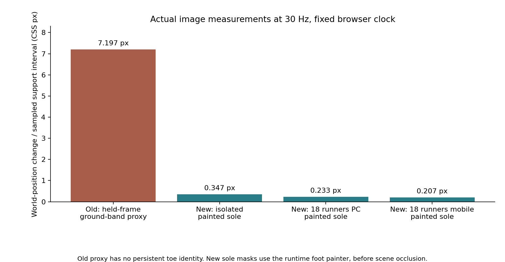

# P型2.5D：脚レイヤー分離・支持足固定の制作レビュー

**総合 REVISE。支持足を独立制御する方式は KEEP。今回の素材を標準Pへ昇格する判断は REJECT。**

指定ブランチ `fix/2p5d-p-canonical-20261011` の最新remoteを明示的に取得し、`9aeed9765fadc0ced0135fb51d7761fdb98756aa` から制作した。単一画像の周期調整で足滑りが改善しなかった結果を受け、P専用の7部品と4脚の接地制御を実制作し、18体レースへ試験実装した。`race-quality.html?selected=2&pRig=1` で動作する。標準の12枚PとS/E/Aは維持した。

## 確認した基準と比較

最上位は [正規P](../public/concept/P.webp) と [正式クリーチャー基準画像](references/evowild-creature-reference-sheet-20260921.jpg)。[参照ロック](2p5d-creature-reference-lock.md)、[既存12枚のレビュー](p-revision-run-review-20261011.md)、[距離同期試験のREJECT結果](evidence/p-foot-world-trace-20261012/RESULT.md) と各証拠画像を確認した。



全身幅を揃え、縦横比は保持。正規だけ比較方向を左右反転した。110pxのシルエットも併記した。赤／スレート、厚い肩、後方の冠、シアン目印、短い鉤尾というPの特徴を引き継いだが、正規と同等の形態品質には達していない。

|部位|既存12枚の実画像で確認した差|新版での変更・残差|
|---|---|---|
|頭|口吻が丸く、頭が横に大きい。8→10で頭部の上下位置が大きく変わる|小さい閉じた口吻。同じ頭部ピクセルを全相で使う。正規の顎・頬の角度は未一致|
|冠|厚い大きな二枚の刃に見え、細い突起の関係が正規と違う|細い後向きの突起へ修正。位相ごとの本数・厚さの変化をなくした。配列はまだ要修正|
|胸・胴|胸から腹の面が簡略化され、伸展時の胴長が変化して見える|頭・胸・胴・尾を一つの固定部品にした。模様の揺れは消えるが、明るい胸と長い低い胴の比率が正規より強い|
|四肢|6→7の前肢展開が急。回収足が手のように垂れ、奥脚の形が読みづらい|前後脚を上部・下部・足に分離。固定骨長の2関節制御。手首の大きな巻き込みを除去。下脚が正規より細く、切り絵の関節が見える|
|爪・足|丸い趾塊と短い爪|低い足甲と分離した尖った爪へ変更。左右の脚は同じ足素材を共有するため、奥行き別の見え方は不足|
|尾|根元が太く、相ごとに鉤の輪郭が揺れる|同一の短い鉤尾を維持。正規より根元が太く、独立した揺れはない|

## 12フェーズと指定遷移

- [修正12フェーズ透明シート WebP](evidence/p-layered-20261012/layered-12-phase.webp) / [PNG](evidence/p-layered-20261012/layered-12-phase.png)
- [修正部品・接点定義](../public/concept/p-layered/atlas.json)
- [既存12枚の無改変コピー](evidence/p-layered-20261012/before-12-phase.webp)
- [6→7、8→10、12→1の旧新版画像](evidence/p-layered-20261012/transition-comparison.png)



これは連続動作を12等分して同じランタイム描画器から出力したシート。実レースはこのシートのコマ送りではなく、分離部品を描画する。旧版の「飛行相」ラベルを新版にそのまま当てはめていない。

|相|既存12枚で見るべき問題|新版の実像|
|---|---|---|
|1|前趾が丸く、胴が低い|前脚支持。低い爪先を固定し、後脚を回収|
|2|支持絵の保持中も足が進む|支持位置を保持して肩が前進|
|3|支持前腕の太さが相ごとに変わる|同じ前腕部品、後脚を胸腹下へ回収|
|4|奥脚と回収脚が重なりやすい|近前脚支持。奥脚の重なりは残る|
|5|回収足が握り手に見える|足甲を低い角度で保持。肘・足首の継ぎ目は見える|
|6|次相へ向けた前脚伸展の準備が不足|後脚着地と前脚離地を重ね、支持を受け渡す|
|7|6→7で前脚が急に伸びる|後脚支持に移り、前脚を連続した軌道で送る|
|8|頭の位置変化が次相で大きい|頭・冠・胸の輪郭は固定。脚の動きと胴体上下動を分離|
|9|8→9の頭部目印移動が大きい|前足を低く前へ送る。頭部だけの飛びはなくなる|
|10|着地へ向けた頭・後足の跳び|後脚支持のまま前脚を伸展。体重移動はまだ機械的|
|11|着地足の趾の丸さと一枚絵の滑り|前足を次の接地点へ向け、後脚支持を保持|
|12|1への接続で脚の位置が跳び得る|奥前脚が接地、近後脚が支持。1へ周期関数で接続|

6→7と8→10で頭・胸・胴そのものが別形状へ変わる問題は除去した。ただし、硬い一体胴と接地を優先した動作は早足寄りで、力強いPの疾走として完成ではない。

## 支持脚と遊脚を分けた描画

`src/p_layered.js` は4本の脚に独立したIDと接地IDを持たせる。支持中は **worldXとレーン座標を保存**し、胴体とカメラだけが進む。遊脚は離地点から次の着地点へ移動し、爪先を低い角度で回収する。遊脚の横移動は胴体のレーン移動を追い、離地時に残った位置差だけを解消する。

周期には実移動量を使うが、それだけを足滑り対策とするものではない。可視の足部品を保存した世界位置へ描画し、肩／腰と足首を固定長の脚で結ぶことが本変更の中心。脚の素材は一定の等方倍率と回転・移動だけで描く。画像の中間補間、光学フロー、ラスタの関節ワープ、相ごとの骨長伸縮は使わない。

前脚は91+91、後脚は89+89のリグ単位。初期試作の不均衡な骨長では、急なレーン移動で足首が内側の到達範囲に入り、下脚と足がずれた。伸び切り側だけの検査では見落としたため、**折り畳み側の到達範囲と、計算後の実際の上下骨長も検査**するよう修正した。支持足を引きずる代わりに胴高も補正するが、深い沈み込みは残課題。

## 足滑りの実測

|条件|観測区間数|平均移動px|最大移動px|連続周期数|
|---|---:|---:|---:|---:|
|旧12枚・単体（接地帯代理）|32|7.197|8.160|13.31|
|新版・単体（足底画素）|280|0.347|3.061|5.09|
|新版・18体PC（P02足底）|227|0.233|0.876|18.11|
|新版・18体モバイル（P02足底）|157|0.207|0.883|11.74|

新版の世界接地アンカーは単体・PC・モバイルとも最大移動 **0px**、支持中のレーン移動も0。骨長の最大誤差は **8.53×10⁻¹⁴リグpx**、伸び切り／折り畳みの到達誤差は0だった。足底画素の変動は上表のとおり残る。

胴高補正の最大値は単体31.576、PC 104.588、モバイル170.207リグpx。これは足滑りとは別の見た目の問題として **REVISE**。

単位はCSS px／隣接した約33.33msの観測。旧版は既存レポートと同じRGBA接地帯代理指標（y=291–295、同じ絵を保持した支持区間の最前方帯）。足の恒久的IDがないため、新版と同じ爪を追った比較ではない。改善率の百分率は出さない。

新版は同じ足ID・接地IDの区間だけを比較する。実際の足画像を実際と同じ変換で透明ROIへ描画し、足底2行の不透明画素中心を世界座標へ戻して測る。アンカーの数値だけで合格にしていない。足全体のアルファ重心も別途保存した。

**限界:** 足マスクは他脚・他個体による遮蔽前の描画。合成済みレース画像からの意味的な爪追跡ではない。支持中の傾き、サブピクセル描画、最下端に選ばれる爪の切替で、アンカー0でも足底画素の変動は残る。`observedStanceRasterSpanPx` は3点以上見えた接地区間の幅で、録画端の部分区間も含む。全18体の足滑りではなく、足底測定対象は選択P02。骨長・到達範囲は画面描画対象のP全5体を確認する。



- [集計](evidence/p-layered-20261012/run-validation.json)
- [旧版生測定](evidence/p-layered-20261012/before-isolated-trace.json)
- [新版単体生測定](evidence/p-layered-20261012/layered-isolated-trace.json)
- [18体PC生測定](evidence/p-layered-20261012/race-18-desktop-trace.json) / [モバイル生測定](evidence/p-layered-20261012/race-18-mobile-trace.json)

## ループ接続

[境界測定](evidence/p-layered-20261012/loop-validation.json) は同じ描画器を平地で動かした結果。周期0と1は関節位置差0、RGBA相違0。6→7、8→9、9→10、12→1の前後0.0001周期で、関節の最大移動は0.17リグpx未満だった。これは境界の不連続がないことの検査であり、隣接する12枚が同じ形という意味ではない。

実レースのカメラ・地形・胴高履歴を含む動きは動画と生測定で別途提示する。平地の端点一致だけで疾走の自然さをKEEPにはしない。

## 実画像・連続動画・18体組込み

- [新版・単体6秒](evidence/p-layered-20261012/layered-isolated.mp4) / [半速12秒](evidence/p-layered-20261012/layered-half-speed.mp4)
- [旧新版の実走行並列動画](evidence/p-layered-20261012/before-after-motion.mp4)
- [PC・18体動画](evidence/p-layered-20261012/race-18-desktop.mp4) / [画像](evidence/p-layered-20261012/race-18-desktop-later.png)
- [モバイル・18体動画](evidence/p-layered-20261012/race-18-mobile.mp4) / [画像](evidence/p-layered-20261012/race-18-mobile-later.png)
- [実フレーム抜粋](evidence/p-layered-20261012/actual-motion-filmstrip.png)

Chromiumでシミュレーション時刻を制御し、60Hzの実ブラウザ画像をffmpegでMP4にした。半速は既存フレームの表示時間を倍にしたもの。画像間補間なし。PC 1280×720、モバイルはPixel 7エミュレーション412×839（動画のみ高さ840へパディング）。実端末の速度・電池・GPU性能を測った結果ではなく、60fpsの実時間性能を保証しない。

18体は全観測で描画対象、うち5体が新版P。画面外の余白まで含む描画対象カウントなので、18体すべての全身が遮蔽なく見えるという意味ではない。PC・モバイルとも群れ内で脚が隠れる。モバイルは下脚・爪の識別が難しく、既存HUDとも重なる。UI配置は今回変更していない。

## 検証・再現・変更範囲

既存 `tests/p-canonical.spec.js` は変更せずPC／モバイル **4/4合格**。新しい `tests/p-layered.spec.js` はPC／モバイル **2/2合格**。4脚の接地ID、支持中の世界位置、全Pの外側／内側到達範囲、実骨長、Pause時の姿勢とResetを確認した。既存カメラはPause中も追従を終えるため、画面座標ではなく世界座標と局所関節位置を検査する。

[既存Pテスト結果](evidence/p-layered-20261012/legacy-test-results.json) / [新版テスト結果](evidence/p-layered-20261012/rig-test-results.txt)。`npm --ignore-scripts run build` と `git diff --check` も合格。既存mainチャンクの500kB警告は残る。全リポジトリのテストは再実行していない。

制作元は参照付き画像編集による [胴・上脚・足の元画像](evidence/p-layered-20261012/parts-source.png) と [下脚の元画像](evidence/p-layered-20261012/lower-parts-source.png)。大きな丸い口吻、灰色の切断面、S寄りに細すぎた下脚の候補は棄却した。パッカーはアルファ連結成分の抽出・切り出しだけで、他の部品のはみ出しを除去する。解剖形状を自動変形していない。

```sh
python scripts/pack-p-layered.py
# Viteを127.0.0.1:4173で起動してから:
node scripts/preview-p-layered.mjs
node scripts/measure-p-layered-loop.mjs
node scripts/capture-p-layered.mjs
python scripts/plot-p-layered-evidence.py
npm --ignore-scripts run build
```

Node依存、Chromium（`CHROMIUM_PATH`指定可）、Python Pillow/NumPy/SciPy/Matplotlib、ImageMagick、ffmpegを使用。ビルドのprebuildを省き、無関係なSモデル生成を避けた。

[変更ファイル一覧](evidence/p-layered-20261012/changed-files.txt) と [ハッシュ・検証記録](evidence/p-layered-20261012/validation.json) を保存した。変更はP専用部品・描画分岐・検証スクリプト・証拠・テスト。正規画像、既存Pシート、S/E/A素材、3Dファイルは変更していない。main・3Dブランチへ書き込んでいない。

## 残る問題と判定

**KEEP:** 4脚の識別、支持／遊脚の分離、世界接地位置の保持、実足画像による測定、頭・冠・胴・尾の相ごとの形態崩れ防止、12→1の周期境界、18体への試験組込み。

**REVISE:** 正規より細い下脚、胴の長さと胸の明るさ、冠と顎の細部、肘・膝の部品境界、近遠脚の素材共有、独立した尾・胸のしなり不足。接地を優先したため飛行区間がなく、蹴り出しと荷重移動が機械的。急なレーン移動では胴高補正が大きい。単体拡大表示と通常レースでは描画寸法に基づく歩幅が異なり、周期速度も異なる。

**REJECT:** 数値だけによる完成宣言、周期同期だけを足滑り修正とする方法、今回の素材の標準Pへの昇格。正規比較・走行品質を満たした明示的KEEPが必要という [AGENTS.mdの昇格条件](../AGENTS.md) を満たしていないため、`pRig=1` の試験実装として提出する。
