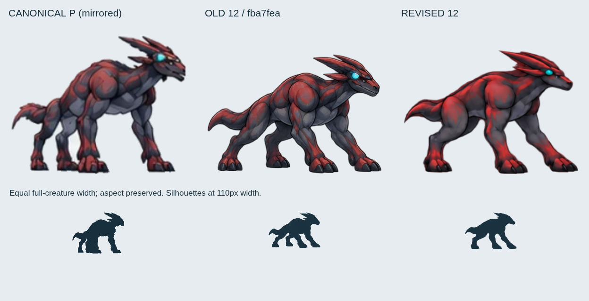
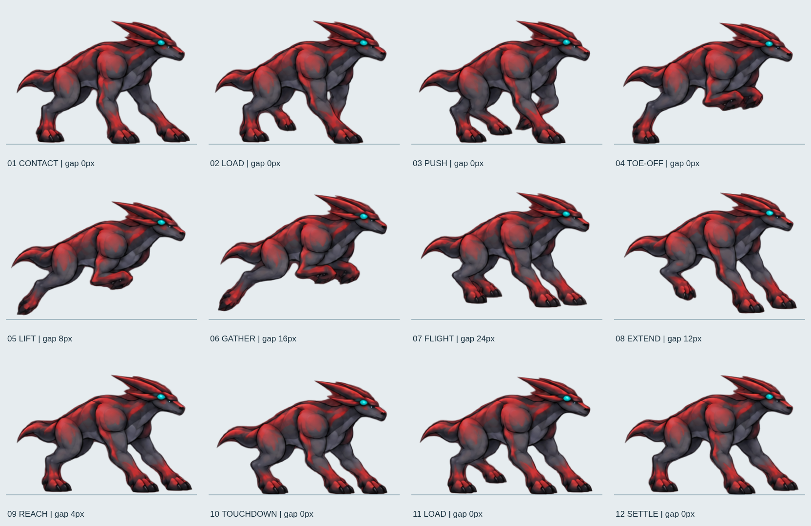

# P型12フェーズ修正レビュー — 2026-10-11

**判定: KEEP（この修正ブランチで旧12枚を置き換える段階改善として）。完成判定ではない。残課題は REVISE。**

対象は `fix/2p5d-p-canonical-20261011` の `fba7fea36227e46d1e50d4b1cc04eb94ff60a6a3`。作業開始時と提出前に remote を取得し、同じ SHA を確認した。旧6枚との比較ではなく、指定された既存12枚との比較である。main、3D系ブランチ、S/E/A素材、正規基準画像は変更していない。

## 基準と実画像

最上位基準は [P.webp](../public/concept/P.webp) と [正式クリーチャー基準シート](references/evowild-creature-reference-sheet-20260921.jpg)。[参照ロック](2p5d-creature-reference-lock.md)、[既存比較レポート](p-canonical-run-review-20261011.md)、その比較・12枚一覧・PC/モバイル証拠、[P gait review](reviews/motion-first-p-phase-d-gait-pass-20260926.md) を確認した。



上図は全身幅を揃え、縦横比を保って比較。下段は幅110pxのシルエット。正規の高い胸、厚い肩、赤／スレートの筋肉、コンパクトな頭と後方へ流れる冠、短い鉤状の尾、シアンの頭部目印を維持した。同じP型と判断する。ただし、正規の静止姿勢より走行姿勢は低く長く、細い爪と尾先、筋肉の境界線の精度は一致していない。

- [修正済み12フェーズ走行シート・RGBA WebP](../public/concept/p-run-sheet.webp)
- [旧12フェーズの無改変アーカイブ](evidence/p-revision-20261011/old-12-phase.webp)
- [全12フェーズの旧新版対照](evidence/p-revision-20261011/old-new-all-phases.png)
- [11→12→1→2 の旧新版対照](evidence/p-revision-20261011/loop-11-12-1-2.png)



## 実画像で特定した問題と変更

|対象|旧12枚で確認した問題|今回の変更と判定|
|---|---|---|
|爪先|丸い塊に見える趾と短い爪|前足を低い足甲と分かれた趾の輪郭へ描き直した。爪先はまだ太い。**KEEP / 細部 REVISE**|
|頭・冠|丸い口吻、冠の厚さと先端の揺れ|口吻の幅を抑え、冠を低く後ろへ流す輪郭に整理。シアン目印を水平方向の位置基準にした。冠の厚さは正規より強い。**KEEP / 細部 REVISE**|
|尾|太いパドル状の先端|短い下向きの鉤と細い先端へ修正。根元と中ほどはまだ太い。**KEEP / 細部 REVISE**|
|前足回収|3〜7、10で手首から垂れた握り手に見える|4〜6は肘から胸下へ畳み、7以降は前腕と足先を前下方へ向けた。10〜12の垂れた手首を接地・荷重姿勢へ変更。5の奥前足は重なりが強く、完全解消ではない。**KEEP / 奥脚 REVISE**|
|荷重・蹴り出し|支持脚と回収脚が読み取りにくい|1〜3の支持、4の後足支持、5〜9の離地、10〜12の着地を分離。支持時間を周期の70%へ設定。水平の足固定は未達。**KEEP / 足滑り REVISE**|
|12→1|後脚位置と輪郭が跳ぶ|11〜12を描き直し、1へ向けて後脚と胴体を戻した。下半身の連続性は改善。**KEEP**|
|走行中の形態|回収脚の輪郭変化、奥脚の消失感|全12枚に同じ拡大率を使用し、部位の変形・縦横別の伸縮・補間は行わない。描画由来の胸厚・模様・奥脚の揺れは残る。**KEEP / 残差 REVISE**|

新しい画像を作るだけでなく、Pの位相計算も修正した。従来の `elapsed × 現在のcadence` は加減速時に過去全体の位相を再計算し、長時間走行後ほど逆行・飛び越しを起こせる。Pだけ固定シミュレーション刻みでcadenceを積算する。S/E/Aの位相計算とレースの速度・競走ロジックはそのまま。

## 接地とループ検証

[画像測定データ](evidence/p-revision-20261011/contact-loop-audit.json) は alpha > 12 の実ピクセルから計算した。テストの合格を造形の合格として扱わない。

|検証|結果|
|---|---|
|サイズ・枚数|1664×960、4列×3行、各416×320、12枚すべて異なる画像|
|足元基準|y=296。最下端の実ピクセルは接地時y=295|
|各相の足元クリアランス|`[0,0,0,0,8,16,24,12,4,0,0,0]` px|
|支持相|1〜4、10〜12に接地帯の実ピクセルあり。4は後足の帯のみ|
|飛行相|5〜9に離地を保持。7の最大クリアランス24px。各相を最低足位置へ再接地する処理なし|
|12→1 全身シルエットIoU|旧0.593 → 新0.825|
|12→1 下半身IoU（y≥190）|旧0.282 → 新0.703|
|12→1 頭部目印の移動|旧7.54px → 新7.03px|
|残る大きな移動|8→9の頭部目印17.3px。9→10も11.7pxあり、着地の上下動はまだ強い|

IoUは輪郭の重なりであり、関節の正しさや滑らかさの点数ではない。特に6→7の前足展開と、8→9の頭部・後足移動は半速で分かる。12→1が良くなっても、周期内の全遷移が解決したとは判定しない。

**足滑りについて:** 支持相の高さは揃ったが、支持足の水平位置を地面へ固定するIKや接地拘束はない。同じ接地絵を保持する区間内で、投影したルート進行は3.67〜9.67pxあった（[測定](evidence/p-revision-20261011/contact-hold-travel.json)）。足自体の自動追跡値ではないが、接地拘束がないことを示す。現状の支持・蹴り出しは絵としての改善で、世界座標の足固定を合格にしたものではない。

## 連続動画と18体レース実装

すべて実際の `race-quality.html` のブラウザ描画を60Hzで収録したMP4。画像を別の動画背景へ合成したものではない。シミュレーション時刻を制御して連続スクリーンショットを保存し、ffmpegで符号化。光学フロー・フレーム間画像補間なし。半速版のみ既存描画フレームの表示時間を2倍にする。

- [単体・6秒の連続走行](evidence/p-revision-20261011/isolated-continuous.mp4) / [半速12秒](evidence/p-revision-20261011/isolated-half-speed.mp4)
- [18体レース・PC動画](evidence/p-revision-20261011/race-18-desktop.mp4) / [組込み画像](evidence/p-revision-20261011/race-18-desktop-later.png)
- [18体レース・モバイル動画](evidence/p-revision-20261011/race-18-mobile.mp4) / [組込み画像](evidence/p-revision-20261011/race-18-mobile-later.png)
- [動画・連続位相・停止／再開初期化の測定](evidence/p-revision-20261011/video-audit.json)
- [連続動画から2フレームごとに切り出した冒頭0.6秒](evidence/p-revision-20261011/continuous-frame-sequence.png)
- [PC全12相の実行時画像](evidence/p-revision-20261011/runtime/desktop-chromium/runtime-contact-sheet.png) / [モバイル全12相](evidence/p-revision-20261011/runtime/android-chromium/runtime-contact-sheet.png)

単体6秒は **13.31周期**、PCレース6秒は **12.07周期**、モバイルレース4秒は **8.04周期**。すべて12相を観測した。通常レースはPC／モバイルとも全収録フレームで描画対象18体。密集時には他個体で足が隠れるため、単体動画と全12相画像も併記した。モバイルでも赤い肩・後方の冠・短い尾は識別できるが、足先の細部は小さくなる。

30秒以上走らせた後の実UI `CONSERVE` 指示でも、位相の逆行なし。8msごとの500点で最大位相進行は0.223周期単位、隣接観測のフェーズ進行は最大1枚。Pause中は位相固定、ResetでP02の初期値0.87へ戻ることを確認した。faviconの既存404のみ収録時に204応答とし、それ以外のコンソールエラーとページエラーは0件。

## 検証と再現

既存 `tests/p-canonical.spec.js` はPC／モバイルで **4/4合格**。テスト内容は変更していない。素材の余白、12枚、飛行高、実行中の全相・ループ、18体、S/E/Aの6相を確認。`npm --ignore-scripts run build` と `git diff --check` も合格。ビルドは無関係なSモデルを生成するprebuildを実行しない。Viteの既存mainチャンクサイズ警告は残る。

詳細は [validation.json](evidence/p-revision-20261011/validation.json)、[Playwright結果](evidence/p-revision-20261011/test-results.json)、[packing-audit.json](evidence/p-revision-20261011/packing-audit.json)。フル回帰スイートは今回再実行していない。旧レポートに記録されたRace Agentの既知失敗を今回の成功件数へ含めていない。

画像制作には参照付きimagegen編集を使った。全12枚を一組として改訂し、垂れた手首が残る候補・端が切れた候補を棄却した。採用元は [generated-source.png](evidence/p-revision-20261011/generated-source.png)。候補間の単純補間、別種からの素材移植、ラスタの関節変形はしていない。

パッキングは連結成分の抽出、全相共通の拡大率、剛体移動のみ。各相別の拡大率で形態の揺れを隠していない。頭部シアン目印のx位置を揃え、足底は予定した離地高へ置く。元画像と製品のハッシュはvalidationに記録。

```sh
node scripts/pack-p-revision.mjs
cmp work/p-revision/candidate.webp public/concept/p-run-sheet.webp
node scripts/audit-p-revision.mjs
# 別ターミナルでViteを起動後:
node scripts/capture-p-revision.mjs
```

Node依存、Chromium（`CHROMIUM_PATH`指定可）、ImageMagick、ffmpegが必要。

**KEEP:** 同じPの造形を保つ段階修正、短い尾先・回収姿勢・12→1の改善、Pの位相積算、PC／モバイルへの組込み。

**REVISE:** 正規より太い爪・冠・尾の根元、簡略化した筋肉境界、4〜6の奥脚の重なり、6→7の伸展、8→10の上下動、水平の足滑り。磨き込み完了としての承認はしない。

**REJECT:** 手首の垂れが残る初期候補、端の切れた候補、数値・テストだけを根拠にした完成判定。
