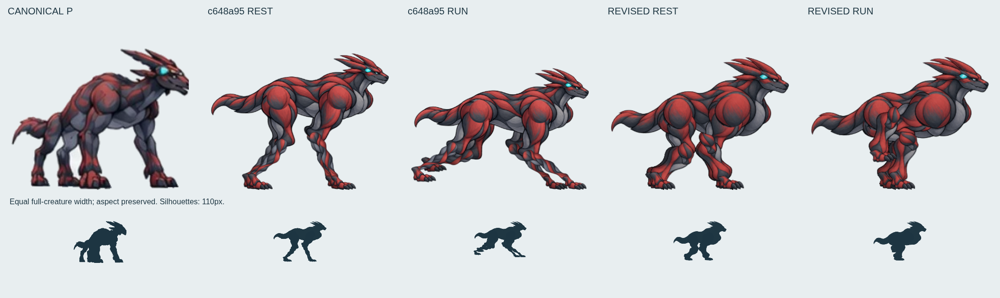
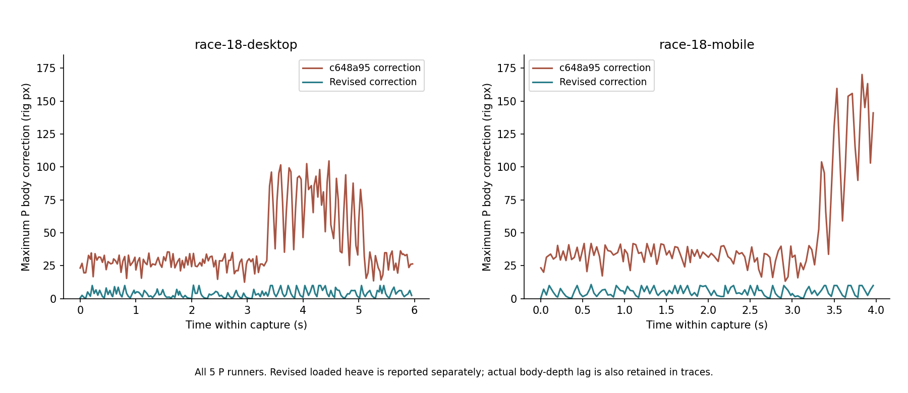
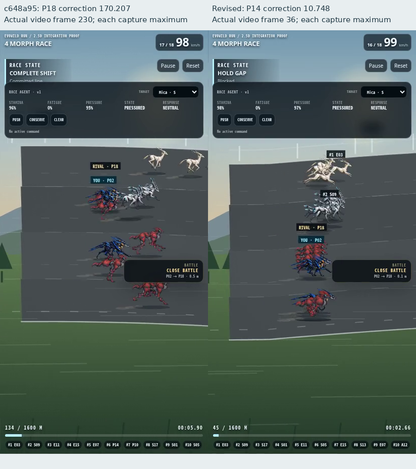
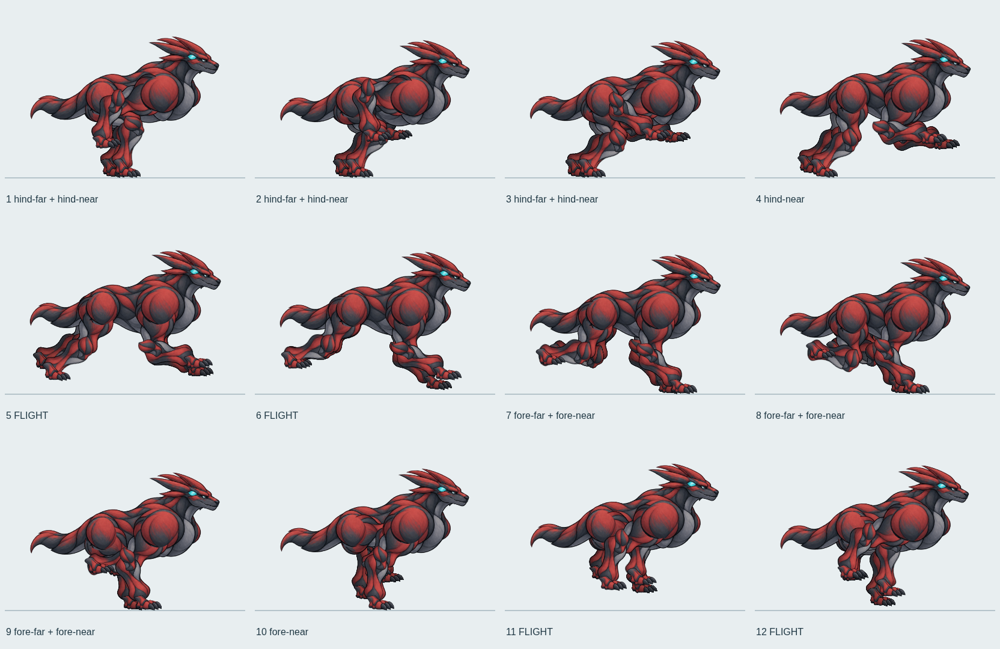

# P型2.5D レイヤーリグ第2改訂 — 2026-10-13

**支持足固定 KEEP。造形・疾走は段階改善を確認したが、総合 REVISE。標準採用禁止を維持する。**

最新remoteを明示的に取得し、`c648a95d61529df3501f8cd11dc65d0712b0fd7e` から制作した。対象は `fix/2p5d-p-canonical-20261011` の `pRig=1`。4本の脚ID・接地ID・世界接地アンカーを継続し、旧12枚方式への復帰はしていない。

## 正規Pとの実画像比較

基準は [P.webp](../public/concept/P.webp)、[正式基準シート](references/evowild-creature-reference-sheet-20260921.jpg)、[参照ロック](2p5d-creature-reference-lock.md)。[前回レポート](p-layered-run-review-20261012.md) と比較・12枚・実走画像を確認した。



全身幅を揃え、縦横比を保持。正規だけ右向きへ反転した。下段は110pxのシルエット。新しい一組の部品を正規Pと前回素材の参照付き画像編集で制作した。体・頭・尾は同じ部品を全相で使用する。

|対象|前回の実像|今回の制作と残差|
|---|---|---|
|下脚|細長い帯状の筋肉。Pより軽い長脚に見える|短く太い下脚へ描き直した。前下脚の中間断面幅19.858→26.456、後下脚18.449→24.165リグpx。骨長も91/89→68へ校正。単なる横引き伸ばしではない|
|肩・胸|横に平たく、肩と腰の量感が同程度。胸の明るい面が強い|前肩を大きく、胸を深く描き直した。肩の重量感は増したが、胸の明るさ・円形の筋肉表現は正規に未一致|
|胴|肩と腰の間が長く、体が軽く見える|部品幅350→316、高さ132.306→143.483、肩腰間119.794→94.997リグpx。厚い短胴へ修正。正規との完全な比率一致ではない|
|肘・膝|細い部品の端と色境界が露出する|丸い重なり端を持つ上下脚と、同じ皮膚色の筋肉カバー2枚を制作。切断端を隠した。黒い輪郭・色の継ぎ目は残るためREVISE|
|頭・冠・尾|全相で安定するが正規との細部差がある|同じPの小頭・後向き冠・シアン目印・短い鉤尾を継続。口吻、冠の太さ、尾根元はまだ要修正|

- [部品画像9枚と接点定義](../public/concept/p-layered/atlas.json)
- [部品の制作元](evidence/p-rig-v2-20261013/parts-source.png)
- [造形測定](evidence/p-rig-v2-20261013/anatomy-measurements.json)
- [肘・膝の実画像拡大比較](evidence/p-rig-v2-20261013/joint-comparison.png)

断面幅は元画像の実アルファを骨軸中央で横断し、部品の固定描画倍率へ換算した値。体の測定は部品単位であり、全身シルエット一致の点数ではない。関節比較は同じ周期割合の旧新版で、再設計した動作のため関節角度も異なる。カバーの存在だけで継ぎ目の品質を合格にしない。

## 接地・レーン移動・胴高

支持足の `worldX` と `worldLane` は接地IDが同じ間、保存したまま動かさない。固定骨長は前後とも上70＋下68リグpx。素材の体形修正に合わせて前回より短く校正したが、動作中の伸縮はない。画像補間・関節ワープもない。

前回は瞬時のレーン位置へ胴を運び、届かなくなった脚に合わせて胴を大きく下げていた。今回は支持脚が許す体の移動範囲を計算し、Pの横移動を制約する。レーン変数もシミュレーション刻みでこの制約へ合わせる。Pの横移動のタイミングは変わるため、旧版と競走経路・結果が同一という検証ではない。

遊脚は接地点を持たず、離地点から次の着地点へ回収する。離地後の横位置差を早めに解消し、足首が固定長の脚から届く回収弧を計画する。**支持足を動かしたり、IKの骨長を伸ばしたりして胴高を隠す処理ではない。**

|条件|前回最大胴高補正|新版最大胴高補正|新版荷重上下動込みの最大沈み込み|
|---|---:|---:|---:|
|単体|31.576|9.708|9.715|
|18体PC|104.588|10.243|17.738|
|18体モバイル|170.207|10.748|17.973|

上表は動画と同時に採った約30Hzの観測点の最大値。追加の別実行では全requestAnimationFrameを記録し、単体375枚、PC375枚、モバイル250枚を観測した。仮想rAFは16ms間隔（約62.5Hz）で、録画の60fpsとは区別する。この全フレーム記録で最大補正は単体10.000、PC10.649、モバイル **12.326** リグpx。荷重上下動込みの最大はモバイル17.973で変わらなかった。30Hz観測の10.748を連続動作の絶対上限とは扱わない。[追加集計](evidence/p-rig-v2-20261013/body-60hz-validation.json) / [再測定ハーネス](evidence/p-rig-v2-20261013/body-validation-harness.mjs.txt)。

単位は416×320のリグpx。補正は `bodyOffset`、荷重上下動込みは `bob + bodyOffset`。頭・尾の先端の絶対移動量や、レーン移動自体の画面移動ではない。通常レースはP全5体の最大値を記録した。





後者は同じ条件での各録画内の最大値。旧P18・フレーム230、新P14・フレーム36であり、同時刻・同個体の画像ではない。体の投影レーンとシミュレーション位置の一時差も隠さず保存した。最大はPC 0.142、モバイル0.148レーンで、今後のREVISE対象。姿勢を保つ横移動制約は残し、全身が瞬間的に別のレーンへ飛ぶ完成判定はしない。

## 疾走の再設計と12フェーズ

後脚対の荷重・蹴り出しから前脚対の着地へつなぐ動作に変更した。4脚は別々の接地IDを持ち、奥脚を0.06周期ずらす。脚ごとの支持率0.30、歩幅352リグ単位。荷重時に最大8リグpx沈み、飛行時に最大14リグpx上がる。小さい前後ピッチも使う。支持→離地→回収→着地を分離し、前回の全周期に接地がある早足を改めた。



- [透明12フェーズPNG](evidence/p-rig-v2-20261013/layered-12-phase.png) / [WebP](evidence/p-rig-v2-20261013/layered-12-phase.webp)
- [実ポーズ・関節・接地データ](evidence/p-rig-v2-20261013/phase-poses.json)
- [6→7・8→10・12→1の境界検証](evidence/p-rig-v2-20261013/loop-validation.json)

12枚は連続リグの等間隔出力で、実レースは部品を直接描画する。飛行相は5、6、11、12。実アルファの接地線からの空隙は順に21、7、28、6px。周期0と1の画像相違は0、関節差0。指定境界の前後0.0001周期の最大関節移動は0.186px未満だった。

蹴り出しと短い飛行区間は以前より明瞭になった。ただし胸・尾の独立したしなりがなく、回収時に前脚と爪が胸下へ密集する。体が硬い切り絵に見える相が残る。Pらしい完成した疾走としてKEEPにはしない。

## 足滑りの測定

|条件|前回の足底移動平均|新版の足底移動平均|新版最大|全P支持アンカー最大移動|
|---|---:|---:|---:|---:|
|単体|0.347|0.260|1.310|0|
|18体PC|0.233|0.228|1.072|0|
|18体モバイル|0.207|0.228|0.871|0|

CSS px／約33.33msの観測。前回も今回も、同じ足ID・接地IDの支持区間だけを比較する。同じ描画器で足の実画像を透明ROIへ描き、足底2行の画素中心を世界座標へ戻した。今回はP02の足画像に加え、全5体20脚の接地IDと世界位置も測定した。骨長の最大誤差は5.69×10⁻¹⁴リグpx、伸び切り・折り畳みの到達誤差は0。

支持アンカー0と、足底画素が完全に同じ位置という結果は区別する。爪の最下端選択、傾き・サイズ・サブピクセル描画による画素変動は残る。歩容を変えたため支持区間の数・長さも異なる。改善率は出さず、接地方式を維持した結果として扱う。足マスクは遮蔽前の描画で、合成画面から全個体の爪を意味的に追跡した値ではない。

- [測定集計](evidence/p-rig-v2-20261013/run-validation.json)
- [単体生測定](evidence/p-rig-v2-20261013/isolated-continuous-trace.json)
- [PC生測定](evidence/p-rig-v2-20261013/race-18-desktop-trace.json) / [モバイル生測定](evidence/p-rig-v2-20261013/race-18-mobile-trace.json)
- [足底画像測定の比較図](evidence/p-rig-v2-20261013/foot-slip-comparison.png)

## 実走行動画と18体組込み

- [単体・6秒・5.56周期](evidence/p-rig-v2-20261013/isolated-continuous.mp4)
- [半速12秒](evidence/p-rig-v2-20261013/layered-half-speed.mp4) / [旧新版の実動画並列](evidence/p-rig-v2-20261013/before-after-motion.mp4)
- [18体PC・6秒・19.68周期](evidence/p-rig-v2-20261013/race-18-desktop.mp4) / [画像](evidence/p-rig-v2-20261013/race-18-desktop-later.png)
- [18体モバイル・4秒・12.79周期](evidence/p-rig-v2-20261013/race-18-mobile.mp4) / [画像](evidence/p-rig-v2-20261013/race-18-mobile-later.png)
- [実ブラウザフレーム抜粋](evidence/p-rig-v2-20261013/actual-motion-filmstrip.png)

シミュレーション時刻を制御したChromiumの実描画を60Hzで保存し、ffmpegでMP4へ符号化した。半速は表示時間の変更のみ。画像間補間なし。PC 1280×720、Pixel 7エミュレーション412×839。実端末の速度・電池・実時間60fpsの保証ではない。通常レースは全観測で18体が描画対象、P5体が新版。密集・画面端・HUDによる遮蔽はある。

## CIの5件の失敗と検証

前回 [build run 38264779614](https://github.com/badjoke-lab/evowild-test/actions/runs/38264779614) は38合格・81スキップ・5失敗。[取得したステップ](evidence/p-rig-v2-20261013/ci-before.json) / [失敗抜粋](evidence/p-rig-v2-20261013/ci-before-failures.txt)。

|前回失敗|切り分け・今回の対応|
|---|---|
|PリグPC・Androidの90秒タイムアウト2件|90回のブラウザ往復と多数のトレース付きassert、毎描画の大きな部品へのCanvas明度フィルタが重かった。ページ内の実描画を約30Hzで収集して一括検証する。遠脚の明度は画像読込時に一度だけ準備。4脚・全Pの接地と骨長、Pause/Reset、3周期の検査は残した。描画資源を共有するCIは1worker、Pテスト予算45秒。単体実行は2件合計約20秒|
|2.5D AgentのS/E応答比較2件|Sは密集圧力でPUSHが抑制され、空いたEより生の応答が低くなっていた。応答は適合度×スタミナ×疲労×圧力であり、生値だけで形態を順位付けできない。同じフレームの状態を取得し、条件を戻した適合度S=1.00、E=0.76と正の応答を検証する。競走の係数やS/E素材は変更していない|
|Motion First AGILITYの保持時間1件|2.2秒の保持期間に対し、リアルタイムの起動・poll後に残時間を読む検査。前回は0だった。3D実装は変更していない。こちらの環境では外部unpkgへのトンネル失敗も切り分け、同じThree.js 0.181.0をローカルから供給する分離実行で合格を確認した|

ローカル初回全体検証は録画との並行負荷・外部CDN未接続・favicon 404等で10失敗だった。[結果](evidence/p-rig-v2-20261013/local-full-first-results.json) を隠さず残した。テスト生成HTMLによる開発サーバの再読込も観測したため、work/test-results/artifactsをVite監視から外した。実際に欠けていたfaviconは透明アイコンを配布して404を解消した。

2.5D関連28件はすべて合格。[結果](evidence/p-rig-v2-20261013/2p5d-test-results.json)。[Motion First分離実行](evidence/p-rig-v2-20261013/motion-first-isolation.json) は1合格・Android対象外1件。ローカルの分離実行は同じ版のnpm依存を読み替えたもので、3Dソースの修正・検査条件の緩和ではない。`npm --ignore-scripts run build`、`git diff --check`も合格。既存の大きいmainチャンク警告は残る。

ローカル全体の再実行は外部CDNを同版npmへ読み替え、SwiftShaderを明示した条件で35合格・81スキップ・8失敗。[全結果](evidence/p-rig-v2-20261013/local-full-serial-results.json)。Pリグ2件・Agent2件・Motion Firstは合格。残ったのは従来Pシートの時刻制御テスト等のタイムアウト・リアルタイム観測差で、関連28件をネイティブ描画条件で実行した際には合格している。ローカル全体の完全合格とは報告しない。

[実装コミットf0dcf17のGitHub Actions](https://github.com/badjoke-lab/evowild-test/actions/runs/38342561747) の **Run E2E suiteは43合格・81スキップ・0失敗**。PC/AndroidのPリグ、Agent比較、AGILITY保持時間を含む前回5件はこの全体E2Eで合格した。対象を絞るgrepや新しいskipは追加していない。

**buildワークフロー全体はFAILURE。** その後の既存 `Capture Motion First visuals`（キャプチャ用追加3D検査）は36合格・1スキップ・2失敗。失敗はbalanced 1600 courseの形態順位バランスとRace Entry countdownの表示文字。2.5D Pの新素材・リグを使用しない3D検査で、3D実装の修正は本作業の禁止範囲なので変更していない。[CI集計とステップ](evidence/p-rig-v2-20261013/ci-final.json) / [ログ集計](evidence/p-rig-v2-20261013/ci-after-summary.txt) / [追加3D失敗詳細](evidence/p-rig-v2-20261013/ci-extra-3d-failures.txt)。ワークフロー全体の成功とは報告しない。

最終の追記コミットは検証資料のみ。アプリ・素材・テスト・設定のハッシュは上記CI実装コミットと同一。

## 再現・変更範囲・残課題

```sh
python scripts/pack-p-rig-v2.py
# Viteを127.0.0.1:4173で起動してから:
node scripts/preview-p-rig-v2.mjs
node scripts/measure-p-rig-v2-loop.mjs
node scripts/capture-p-rig-v2.mjs
python scripts/audit-p-rig-v2.py
```

パッカーはアルファ連結成分の抽出と切り出し。生成後に下脚を横へ引き伸ばす補正はしていない。旧部品との比較はgitから前回SHAの素材を読む。測定・動画・実装のハッシュと [変更ファイル一覧](evidence/p-rig-v2-20261013/changed-files.txt) は [validation.json](evidence/p-rig-v2-20261013/validation.json) に記録する。

**KEEP:** 4脚独立・世界接地アンカー、全Pの接地計測、固定骨長、巨大な胴高補正を使わない支持拘束、荷重・蹴り出し・飛行の分離、同じ部品による形態の安定。

**REVISE:** 正規に完全一致しない口吻・冠・尾・胸の色と比率、関節カバーの黒い輪郭と色境界、胸下の前脚・爪の密集、独立した体幹・尾のしなり不足、レーン投影の一時差。PC/モバイルの密集時に脚が隠れる。造形と疾走の完成判定にはしない。

**REJECT:** 標準Pへの昇格、数値やテスト合格だけによる完成宣言。`pRig=1` の試験実装として提出し停止する。正規画像・既存Pシート・S/E/A素材・3D実装・main/3Dブランチは変更していない。
