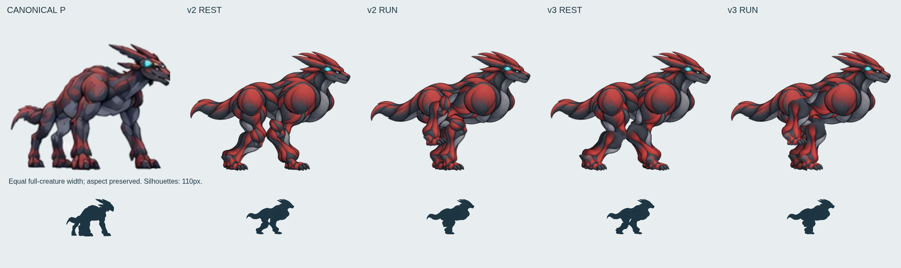
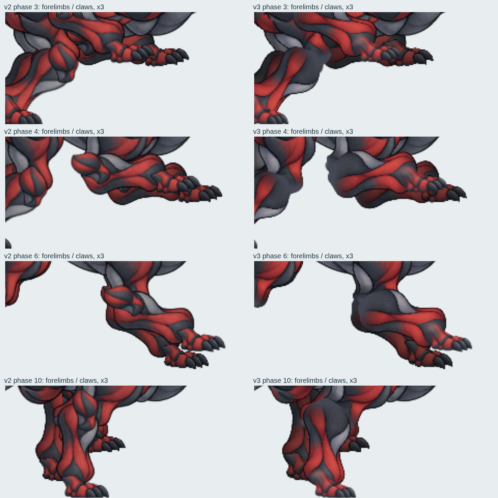
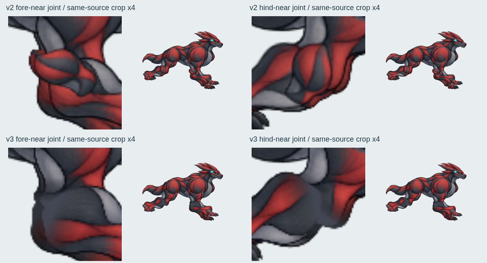
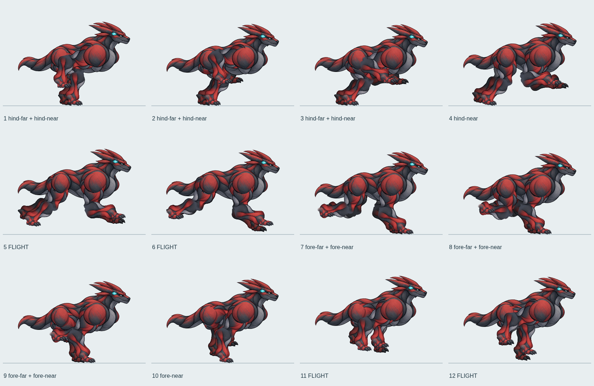

# P型2.5D レイヤーリグ v3 — 前脚の重なりと関節素材

**総合 REVISE。支持足固定方式はKEEP。標準採用禁止を継続する。**

最新remoteを取得し、`eaf0d9f4bba027f6b72eba49f48d00d5d9d61225` と一致した地点から制作した。対象は同じ `fix/2p5d-p-canonical-20261011` の `pRig=1`。正規基準は [P.webp](../public/concept/P.webp)、[正式基準シート](references/evowild-creature-reference-sheet-20260921.jpg)。[v2比較・測定](p-rig-v2-review-20261013.md) の実画像も確認した。

## 制作結果と実画像



全身幅を揃え、縦横比を保持。正規のみ右向きへ反転。下段は110pxシルエット。頭・冠・胴・胸・尾の部品はv2と同一で、今回の限定対象である四肢の接続と足先を改訂した。正規の完全再現という評価ではない。



- 近側の3本の爪に対し、奥側は3本目が隠れる側面用の足先素材を制作した。奥脚には読込時に明度0.68・彩度0.8の陰影を適用する。各足の接地点・足首はv2と同じ。
- 奥側の後脚→前脚→胴→近側の後脚→前脚の順に描く。前後両側で前脚が同じ側の後脚より手前になる。胴が奥脚の付け根を隠し、近側の肩・腰は既存の体表クリップでつなぐ。
- 爪の扇形の重なりは減った。回収中の前脚軌道は近接したままなので、胸下の密集そのものの完全解消には至っていない。



- 上下脚の接続端と、黒い閉じた輪郭を持たない灰色の皮膚パッチを参照付き画像編集で制作した。旧版の赤い輪状カバーを置き換えた。
- 接続端を同じスレート色へ固定の素材ブレンドでつなぎ、パッチを上下脚の背後へ描く。画像アルファは保持し、接続部を透かして隠していない。フレーム補間・関節ワープ・動作中の骨伸縮はない。
- 黒い横断線と赤い腕輪状の段差は減った。一方、拡大すると灰色の接続面の平坦さ、色の切り替わり、外側輪郭の段差が残る。自然な皮膚・筋肉の連続としてはREVISE。

[新しい部品一式](../public/concept/p-layered-v3/) / [実際に読込・接続処理した部品画像](evidence/p-rig-v3-20261013/runtime-parts.png) / [素材制作元](evidence/p-rig-v3-20261013/parts-source.png) / [近側足先の制作元](evidence/p-rig-v3-20261013/near-paw-source.png)。

v2の `public/concept/p-layered/` と既存資料は変更せず、新素材を `public/concept/p-layered-v3/` に置いた。[v2の描画コードと素材の保存コピー](evidence/p-rig-v3-20261013/v2-snapshot/) も含める。

## 12フェーズと走行比較



- [12フェーズ新旧並列](evidence/p-rig-v3-20261013/12-phase-before-after.png)
- [透明PNG](evidence/p-rig-v3-20261013/layered-12-phase.png) / [WebP](evidence/p-rig-v3-20261013/layered-12-phase.webp)
- [同一相の関節座標比較](evidence/p-rig-v3-20261013/phase-geometry-comparison.json) / [ループ境界検査](evidence/p-rig-v3-20261013/loop-validation.json)
- [v2・v3実走行動画の並列比較（左v2、右v3）](evidence/p-rig-v3-20261013/before-after-motion.mp4)
- [新版単体6秒](evidence/p-rig-v3-20261013/isolated-continuous.mp4) / [半速](evidence/p-rig-v3-20261013/layered-half-speed.mp4)
- [18体PC・6秒](evidence/p-rig-v3-20261013/race-18-desktop.mp4) / [画像](evidence/p-rig-v3-20261013/race-18-desktop-later.png)
- [18体モバイル・4秒](evidence/p-rig-v3-20261013/race-18-mobile.mp4) / [画像](evidence/p-rig-v3-20261013/race-18-mobile-later.png)
- [今回同条件で再録したv2の動画・生データ](evidence/p-rig-v3-20261013/before/)

実ブラウザの画像を60fpsで保存してMP4へ符号化。画像間補間なし。仮想時計でシミュレーションを進めているため、実時間60fpsの性能保証ではない。PC 1280×720、Pixel 7エミュレーション412×839。実端末での検証ではない。18体は描画対象数であり、全身が常時遮蔽されずに見える数ではない。

## 接地・骨長・胴高・レーン位置

全4脚ID・接地ID・世界接地アンカー、上70＋下68リグpxの固定骨長、レーン移動制約、支持率0.30、歩幅352、蹴り出しと飛行区間、体幹の荷重上下動・ピッチはv2を維持した。身体部品と足首→足底の物理校正も同一。

[制御コード・素材保護・四肢寸法の検証](evidence/p-rig-v3-20261013/control-and-asset-preservation.json) は、接地・IK・レーン制約のコードがv2とバイト単位で一致することを検査する。新旧の生測定も併記し、数値が合うことと造形品質の合否は分けて扱う。

|条件|支持脚の世界位置変化（v2 / v3）|最大胴高補正（v2 / v3）|荷重上下動込み最大（v2 / v3）|最大レーン差（v2 / v3）|
|---|---:|---:|---:|---:|
|単体|0 / 0|10.000007 / 10.000007|10.014892 / 10.014892|0.00001287 / 0.00001287|
|18体PC|0 / 0|10.649232 / 10.649232|16.844744 / 16.844744|0.00003594 / 0.00003594|
|18体モバイル|0 / 0|12.326241 / 12.326241|17.837328 / 17.837328|0.00002146 / 0.00002146|

胴高は416×320のリグpx。補正は `bodyOffset`、荷重上下動込みは `bob + bodyOffset`。レーン差は要求レーンと描画レーンの差の絶対値。今回の同条件再録の観測最大であり、連続動作の絶対上限を保証する値ではない。前回資料と今回再録の値の違いを新しい制御改善とは主張しない。

単体375、PC375、モバイル250の全requestAnimationFrameを収集。仮想rAFは16ms間隔で、保存動画の60fpsとは区別する。新旧合計1000組の制御フレームに差分は0。PCの1832区間、モバイルの1231区間について、全5体20脚の同一接地ID間のアンカー変化は0だった。各脚の観測数は [全20脚CSV](evidence/p-rig-v3-20261013/all-20-feet.csv)、個体ごとの最大値・時刻は [個体別記録](evidence/p-rig-v3-20261013/per-runner-maxima.json)、全フレーム比較は [新旧測定比較](evidence/p-rig-v3-20261013/before-after-measurements.json) に保存した。

骨長誤差は浮動小数点丸めの範囲、到達誤差は0。12フェーズの全関節座標差は0、周期0→1の画像差も0。膝・肘の物理を変えて画面上の継ぎ目だけを隠す修正ではない。

下脚の中央アルファ断面幅は前脚26.456→30.846、後脚24.165→27.644リグpx。両下脚の骨長68px、肩・腰の位置、体部品は同じ。細長い旧版への復帰はしていない。この断面計測は輪郭の太さの検査で、正規一致の点数ではない。

単体5.555周期、PC19.544周期、モバイル12.743周期を録画した。


## 足素材による画素上の移動

同じ実走姿勢・接地変換にv2とv3の実際の足描画器を当て、足底2行とアルファ重心を比較した。対象はP02、全rAF、16ms間隔、CSS px換算。全20脚のアンカー検査は上表で別に行っている。

|条件|足底画素の移動平均 v2→v3|最大 v2→v3|画素重心の移動平均 v2→v3|
|---|---:|---:|---:|
|単体|0.302→0.383|5.816→4.313|0.024→0.027|
|18体PC|0.250→0.263|1.023→1.404|0.069→0.061|
|18体モバイル|0.205→0.197|0.871→0.903|0.080→0.071|

支持点は0移動でも、傾斜面での足の傾き、爪の最下端の切替、サブピクセル描画により画素位置は変わる。新版では単体・PCの足底画素の平均移動が増えた。足底の画素揺れが完全に改善したとは報告しない。PCでの最大1.404pxなどの残差も残す。足素材は遮蔽前の透明ROIで計測し、合成レース画面の全爪を画像認識で追跡した値ではない。

[同一姿勢での足画像集計](evidence/p-rig-v3-20261013/paired-raster-validation.json) / [生データ](evidence/p-rig-v3-20261013/paired-raster-frames.json)。

## 検証・再現

初回の新版録画はViteのベースパス外 `/favicon.ico` の404で停止した。[ログ](evidence/p-rig-v3-20261013/capture-first-favicon-error.txt)。素材読込の失敗ではなく、配布済み `public/favicon.ico` はベースパス内で200だった。録画ハーネスで同じ実ファイルを供給して再録し、最終動画3本のエラーは0。アプリのHTML・UI・faviconファイルは変更していない。

```sh
python scripts/pack-p-rig-v3.py
# Viteを127.0.0.1:4173で起動
node scripts/preview-p-rig-v3.mjs
node scripts/measure-p-rig-v3-loop.mjs
P_CAPTURE_VERSION=v2 node scripts/capture-p-rig-v3.mjs
P_CAPTURE_VERSION=v3 node scripts/capture-p-rig-v3.mjs
python scripts/audit-p-rig-v3.py
node scripts/measure-p-rig-v3-raster.mjs
```

PC・Androidの既存Pリグ検査と2.5Dレース検査は **24合格・0失敗**。[全結果](evidence/p-rig-v3-20261013/2p5d-test-results.json)。テスト・閾値・skip・CI設定は変更していない。今回、全体の3D検査はローカル再実行していない。

`npm --ignore-scripts run build` と `git diff --check` 合格。Sモデル生成のprebuildは実行していない。既存の大きいmainチャンク警告は残る。101点の既存publicファイルが開始SHAとバイト一致し、v2素材・正規画像・S/E/A・3D素材を含めて保持した。


[変更ファイル一覧](evidence/p-rig-v3-20261013/changed-files.txt) / [成果物ハッシュ・動画情報・検証記録](evidence/p-rig-v3-20261013/validation.json)。

## 残る問題と判定

**KEEP:** 世界接地アンカーと4脚独立制御、固定骨長、胴高・レーン拘束、既存の蹴り出し・飛行。v2の短く太い下脚と肩・胸の量感の継続。

**REVISE:** 胸下の前脚軌道の密集、灰色の関節接続面の平坦さと一部の境界、正規との肩・胸の面構成の差。頭・冠・尾および体幹の独立したしなりの既存課題は今回の限定範囲外で継続している。局所の読取りは改善したが、正規造形への一致と疾走品質全体のKEEP判定にはしない。

**REJECT:** 標準採用、数値やテストPASSだけによる完成判定。main・3D・S/E/A・正規基準・既存v2素材は変更しない。
