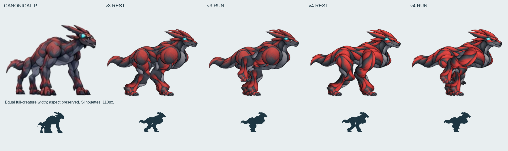
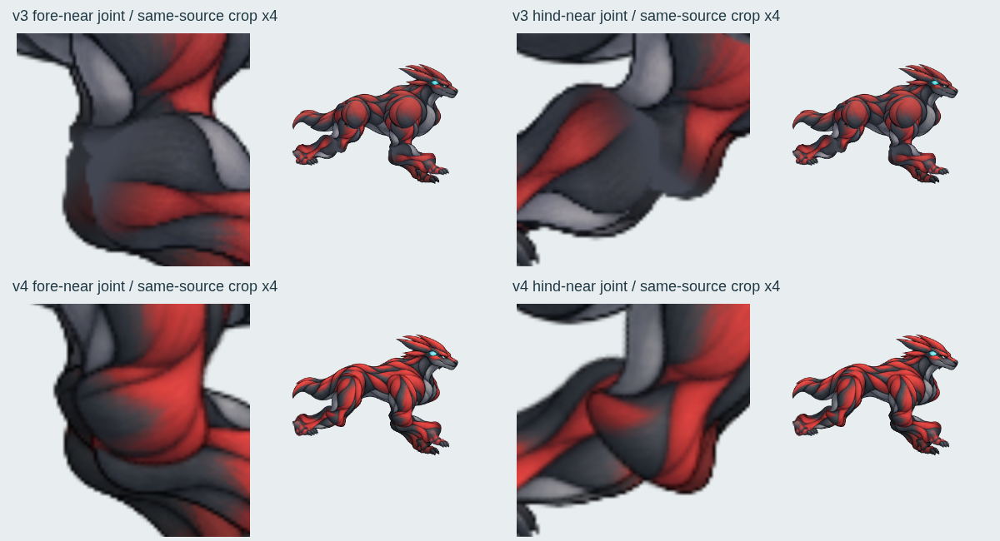
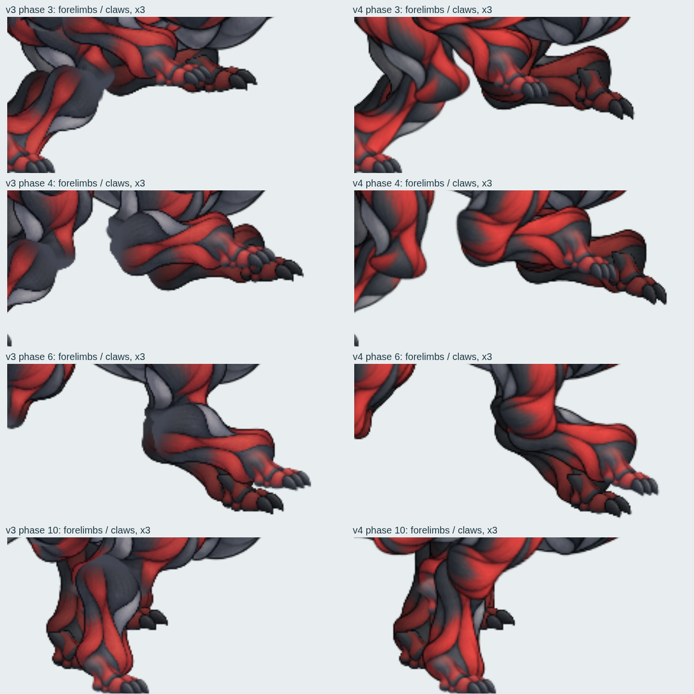
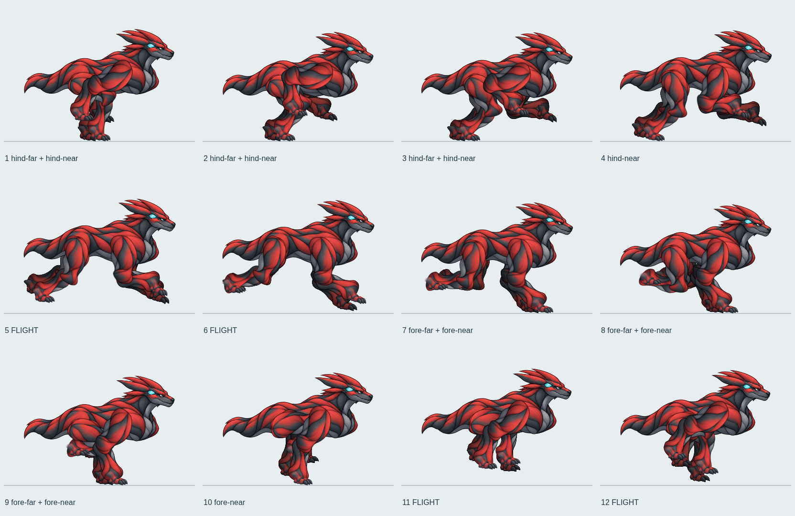
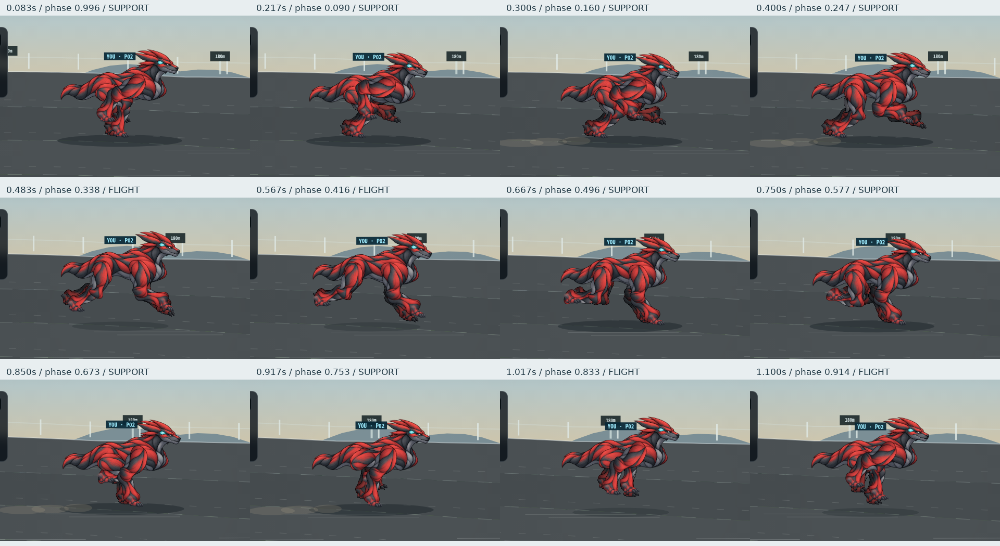

# P型2.5D レイヤーリグ v4 — 胸郭・四肢素材と前脚回収

**総合 REVISE。支持足固定方式はKEEP。標準採用禁止を継続する。**

最新remoteを取得し、`6025245731c2484bfaab5e2817f06cc8e804716a` と一致した地点から制作した。同じ `fix/2p5d-p-canonical-20261011` の `pRig=1` のみを更新。最上位基準は [正規P](../public/concept/P.webp)。[正式基準シート](references/evowild-creature-reference-sheet-20260921.jpg)、[v3の実画像と測定](p-rig-v3-review-20261013.md) も確認した。

## 正規・v3・v4の実画像



全身幅を揃え、縦横比は保持。正規だけ右向きへ反転した。下段は110px幅のシルエット。

|部位|正規に対するv3の差|v4の結果|
|---|---|---|
|肩・胸|肩が輪郭線で囲まれた円盤状。明るい胸下が膨らみ、上腕がそこから別部品として出る|胸郭と肩甲部を斜めの筋肉面へ描き直し、近側上腕の筋肉を一体の輪郭として描く。円形の再描画クリップを撤去|
|前脚|肘に平坦な灰色面。両前脚を同じ高さへ折り畳み、爪が重なる|赤い筋・腱が肘まで続く上腕と前腕を新規制作。奥脚を低め・早め、近脚を高め・遅めに回収し、到達時は爪先を下へ向ける|
|胴体|正規より水平で低い姿勢。肩と腰の高低差が少なく、胴が長く見える|胸下の余分な膨らみを減らしたが、肩・腰の物理位置は保持。全身比率の差は残る|
|四肢の重量感|v3の太さはあるが接続面が平坦|下脚中央のアルファ断面幅は前30.846→33.680、後27.644→27.663リグpx。骨長はいずれも68pxを保持|

[シルエットの外接寸法](evidence/p-rig-v4-20261014/silhouette-proportions.json) の高さ／幅は正規0.795、v3静止0.747、v4静止0.747。局所の筋肉面は変わったが、全身比率が正規へ一致したとは評価しない。正規は高い肩から前脚へ荷重が落ちるのに対し、v4も低く水平な構えが残る。

## 新規素材と接続

[v4部品一式](../public/concept/p-layered-v4/) / [制作元の透明画像](evidence/p-rig-v4-20261014/parts-source.png) / [実際に読込んだ部品](evidence/p-rig-v4-20261014/runtime-parts.png)

新規の実画像は胴・胸郭、前上腕、前腕、後上脚、後下脚の5点。正規Pと既存部品を参照して画像編集で制作し、連結成分で切り出した。画像のポーズ補間や関節ワープは使わない。制作元右側の肘カバー案は実描画には使っていない。

- 灰色へ塗り潰す実行時の端部グラデーションと独立した関節パッチを撤去。
- 下脚→上脚の順で、描かれた筋肉の端を重ねる。上腕の赤い面が肘まで続く。
- 奥後脚→奥前脚→胴→近後脚→近前脚の順。近肩・近腰を円形クリップで胴へ塗り戻す処理も撤去した。
- 足画像6点と足首／足底の物理校正はv3を保持。実行時は既存v3の足画像URLを共有する。v4ディレクトリ内にも同じ足画像を保存したが、新規制作した足とは扱わない。



平坦な灰色面は赤い筋肉の描画へ置き換わった。一方、肘の外周に輪状の重なり線があり、屈曲時の上腕は筒状に見える相がある。足首側の切り出し境界も残る。自然な連続面の完成判定にはしない。



前脚の空中軌道だけを修正した。従来64pxの持上げを近側54px・奥側42pxにし、前進イージングに接地端で0になる差分を加えた。着地前は爪先を下へ向ける。支持相・接地ID・接地点・歩幅352・支持率0.30・近遠の位相差・飛行区間は変更していない。

## 12フェーズ・実走行動画



- [透明PNG](evidence/p-rig-v4-20261014/layered-12-phase.png) / [WebP](evidence/p-rig-v4-20261014/layered-12-phase.webp) / [v3とv4の12相並列](evidence/p-rig-v4-20261014/12-phase-before-after.png)
- [v3左・v4右の連続動画比較](evidence/p-rig-v4-20261014/before-after-motion.mp4)
- [v4単体6秒・5.555周期](evidence/p-rig-v4-20261014/isolated-continuous.mp4) / [半速](evidence/p-rig-v4-20261014/layered-half-speed.mp4)
- [18体PC・6秒・19.544周期](evidence/p-rig-v4-20261014/race-18-desktop.mp4) / [PC実画像](evidence/p-rig-v4-20261014/race-18-desktop-later.png)
- [18体モバイル・4秒・12.743周期](evidence/p-rig-v4-20261014/race-18-mobile.mp4) / [モバイル実画像](evidence/p-rig-v4-20261014/race-18-mobile-later.png)
- [同条件で再録したv3](evidence/p-rig-v4-20261014/before/) / [開始時のv3描画コード](evidence/p-rig-v4-20261014/v3-snapshot/p_layered.js)



動画の実フレームを抜き出した。0.400秒付近の後脚蹴り出し→0.483/0.567秒の飛行→0.667秒の前脚接地→0.850/0.917秒の前脚荷重→1.017/1.100秒の回収・飛行を確認できる。胴体は落下・荷重の上下動を保持する。前脚回収の爪の位置差は読めるようになったが、肩の面が硬く回転し、体幹と肩甲部のしなりは不足している。

実ブラウザの画面を60fpsで保存してMP4へ符号化。画像間補間なし。仮想時計のため実時間60fps性能の保証ではない。PC1280×720、Pixel 7エミュレーション412×839・DPR1。物理モバイル端末ではない。18体は描画対象数であり、重なりで隠れる個体・四肢はある。

## 全20脚の接地・骨長・胴高・レーン

PC375フレーム、モバイル250フレームの全rAFで、5体×4脚の支持IDを追跡した。同一接地ID内の世界X・世界レーン変化は全脚0。上70＋下68リグpxの骨長、到達誤差0を保持。最大骨長誤差は7.11e-14リグpx。

|条件|支持アンカー移動 v3→v4|最大胴高補正 v3→v4|荷重上下動込み最大 v3→v4|最大レーン差 v3→v4|
|---|---:|---:|---:|---:|
|単体|0→0|10.000007→10.000007|10.014892→10.014892|0.00001287→0.00001287|
|18体PC|0→0|10.649232→10.649232|16.844744→16.844744|0.00003594→0.00003594|
|18体モバイル|0→0|12.326241→12.326241|17.837328→17.837328|0.00002146→0.00002146|

胴高は416×320リグpx。補正=`bodyOffset`、上下動込み=`bob+bodyOffset`。レーン差は要求レーンと描画レーンの差。観測期間の最大で、絶対上限とは主張しない。

[全20脚CSV](evidence/p-rig-v4-20261014/all-20-feet.csv) / [個体別最大値と時刻](evidence/p-rig-v4-20261014/per-runner-maxima.json) / [独立した新旧走行測定](evidence/p-rig-v4-20261014/before-after-measurements.json)

さらにv3とv4の実コントローラへ同じレース入力を与え、両方の実足描画器で全20脚の足底画像を計測した。支持関節・胴高・レーン・支持足ラスタ位置の新旧差はいずれも0。PC1832、モバイル1231の同一接地区間で比較した。

|条件・対象|足底X移動平均 v3→v4|最大 v3→v4|足画像重心X移動平均 v3→v4|
|---|---:|---:|---:|
|単体4脚|0.383→0.383|4.313→4.313|0.027→0.027|
|18体PC・20脚|0.299→0.299|1.838→1.838|0.059→0.059|
|18体モバイル・20脚|0.207→0.207|0.943→0.943|0.076→0.076|

足底Yは投影された接地点Yを引き、残差のフレーム間変化を測定した。平均／最大は、isolated-continuous: 0.044917 / 1.000000 px（v3/v4同値）、race-18-desktop: 0.105895 / 1.000000 px（v3/v4同値）、race-18-mobile: 0.064988 / 1.000000 px（v3/v4同値）。

CSS px、16ms間隔。Xはカメラ移動を除いた世界位置換算。接地アンカー0移動でも、地面に合わせた傾き・爪の最下端の切替・サブピクセル描画で足底画素は動く。この残差を0とは報告しない。前回v3の足画像測定はP02だけだったが、今回は全20脚なので過去の最大値と直接比較しない。画素測定は遮蔽前の透明ROIであり、合成レース画面で全脚を画像認識追跡した値ではない。

[足画像の全20脚比較](evidence/p-rig-v4-20261014/all-20-contact-validation.json) / [脚別CSV](evidence/p-rig-v4-20261014/all-20-foot-raster.csv) / [生データ](evidence/p-rig-v4-20261014/all-20-contact-frames.json)

初回、同じ足PNGを別URLで読み込むと、姿勢が同一でも測定ROIで微小なラスタ差が生じた。[初回記録](evidence/p-rig-v4-20261014/initial-raster-resource-difference.json)。既存v3の足画像リソースを共有すると同時比較で差が消えた。足を移動して数値を合わせた修正ではない。

[ループ検査](evidence/p-rig-v4-20261014/loop-validation.json)：周期0と1の関節差・画像差0。6→7、8→9、9→10、12→1の境界前後±0.0001周期で最大関節移動0.186リグpx未満。これは平地の相検査で、履歴を持つ接地検査は動画のトレースで別途実施している。

## 検証と変更範囲

`src/p_layered.js`、新しい `public/concept/p-layered-v4/`、v4制作・検証スクリプト、本レビューと証拠を変更した。[変更ファイル一覧](evidence/p-rig-v4-20261014/changed-files.txt)。

[保護検査](evidence/p-rig-v4-20261014/control-and-asset-preservation.json) で開始時のpublic全115ファイルがバイト一致。v2・v3素材、正規画像、S/E/A、3D素材を保持。main・他ブランチへの操作なし。支持計画・レーン制約・IK・到達補正など6コード区間も一致し、画像側の切出し座標と物理側のv3校正を分けて保存した。

ローカルのPC／Android 2.5D検査は **23合格・1失敗・0skip**。[24件の検査結果](evidence/p-rig-v4-20261014/2p5d-test-results.json) と [成果物検証記録](evidence/p-rig-v4-20261014/validation.json) に保存した。失敗はAndroidの `p-layered.spec.js:54`：胴高補正の上限12に対して12.326240757854364を観測した。同じ入力のv3にも同値があり、新旧の差は0。従来の30Hzサンプリングが16msごとのピークを拾うかで合否が変わる不整合であり、タイムアウトではない。閾値緩和や採取位置の変更でPASSにしていない。テスト・閾値・skip・CI設定は変更しない。`npm --ignore-scripts run build` 合格。既存mainチャンクのサイズ警告は残る。

開始commitの[GitHub Actions 38396008468](https://github.com/badjoke-lab/evowild-test/actions/runs/38396008468)は全体E2E **43合格・81skip・0失敗**。その後の3D `Capture Motion First visuals` で `motion-first.spec.js:1735` のbalanced 1600 field判定が1件失敗した（同ステップ37合格・1skip）。PのPC／Androidタイムアウトではない。今回3Dへ修正は加えない。

再現順序：

```sh
python scripts/pack-p-rig-v4.py
# Viteを127.0.0.1:4173で起動。src変更時には再起動する。
node scripts/preview-p-rig-v4.mjs
node scripts/measure-p-rig-v4-loop.mjs
P_CAPTURE_VERSION=v3 node scripts/capture-p-rig-v4.mjs
P_CAPTURE_VERSION=v4 node scripts/capture-p-rig-v4.mjs
node scripts/measure-p-rig-v4-contacts.mjs
python scripts/audit-p-rig-v4.py
```

## 判定と残る問題

**KEEP：** 4脚独立接地、世界アンカー、固定骨長、胴高・レーン制約、蹴り出しと飛行区間。新しい素材でも測定区間の接地品質を維持。

**REVISE：** 正規の肩高・胸の前傾・胴体比率へは未到達。平坦な灰色継ぎ目と前脚の密集は減ったが、肘の輪状境界、屈曲時の筒状の上腕、肩甲部と体幹のしなり不足が残る。既存Androidテストの胴高上限12とv3からの実測12.326の不整合も未解消。頭・冠・尾にも正規との差がある。造形と疾走全体のKEEPとはしない。

**REJECT：** 標準採用、テストPASSのみでの完成宣言。v4の実物・比較・測定を保存してこの工程で停止する。
